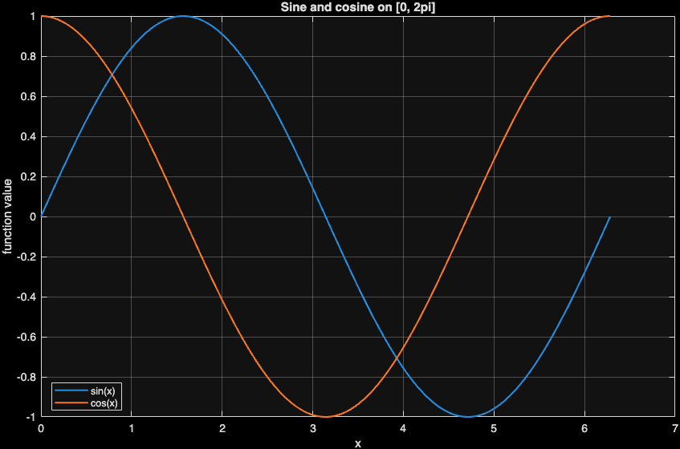
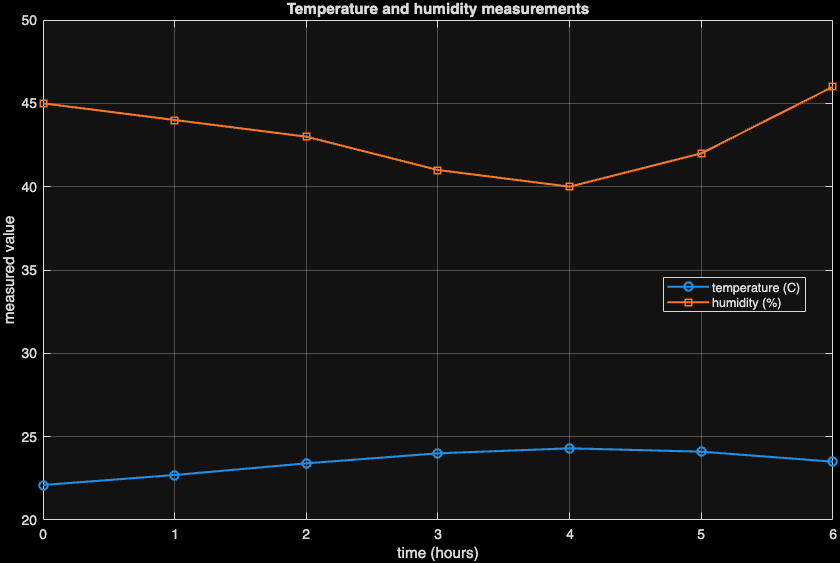
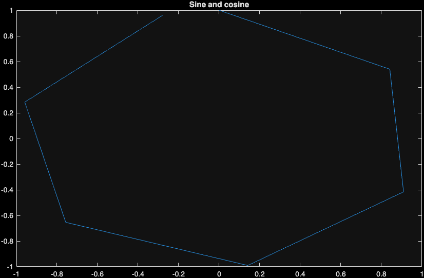

::: {.callout-note}
Use this chapter with the [companion reading guide](how-to-use.html).
**Nothing in this chapter is collected or graded.** The approved syllabus,
workload guide and Blackboard remain authoritative.
:::

## Your route {#route}

**What mathematical object does each array represent, and how will we check it?**

An array is more than a box of numbers. Its shape and indexing encode
whether it represents sampled inputs, several measured variables or a linear
system. A script preserves the recipe; a plot communicates part of the evidence.

We sample sine and cosine, check a mathematical identity, solve a small linear
system and read measurement columns. The supplied AI plot runs, but its axes
answer a different question from the requested two function graphs.

[Before you start](#before-start) · [Words used here](#words) · [Setup](#setup) ·
[Meeting 1](#meeting-one) · [Meeting 2](#meeting-two) · [AI audit](#ai-audit) ·
[Practice and resources](#practice) · [Chapter list](chapters.html).
The page contents navigation also links to the sections.

::: {.callout-tip}
## A first 30-minute recovery session

Choose a stopping point within about 30 minutes; continue from there next time.
This is an untested first-pass budget, not a completion promise. 

1. Check prerequisites and setup. If access is blocked, focus on that first.
2. Read row/column indexing and the sampled sine/cosine script; state what x and y represent.
3. Inspect the identity error and the meaning of the two plotted axes.
4. Try the second self-check and continue Core 3, 6 or 7. The linear-system reference is Guided 5.

Read displayed results when jumping ahead; run complete code in its stated
sequence when returning to your script. The full practice selection is Core
**1, 2, 3, 4, 6, 7**, selective Guided **5**, and optional Extension **none**,
within the **90–120-minute** ordinary-week budget.
:::

### Before you start {#before-start}

No previous MATLAB week is assumed. You need basic algebra, coordinates
and the ability to save/open a file. Run the MATLAB setup check on your
working computer. In MATLAB, open a new script, save its .m file in your week01
folder, then run it; keep experiments you want to reproduce in that file.

Use [software requirements](https://lnajman.github.io/math346/resources/software-requirements.html) and the
[course glossary](https://lnajman.github.io/math346/resources/glossary.html) when needed. You do not need a
paid AI account or an external AI call: the flawed examples are supplied locally.

::: {.callout-note #words}
## Words used in this chapter

| Word or pattern | Meaning here |
|---|---|
| **Array shape** | The number of rows and columns, displayed by size. |
| **Row / column vector** | One row of values versus one column of values. |
| **Index** | A position in an array; MATLAB begins at one. |
| **Colon in indexing** | Select all positions in a row/column, as in A(:,2). |
| **Sampled function** | Function values evaluated at a finite ordered list of input points. |
| **Elementwise operation** | Apply an operation separately to corresponding entries, using dots where needed. |
| **Matrix product** | A linear-algebra combination of rows and columns, not entry-by-entry multiplication. |
| **Residual** | What remains when a computed solution is substituted into the original equation. |
| **Tolerance** | A small numerical scale used to judge floating-point disagreement. |
:::

### Read / Explain / Check / Interpret

Read the inputs and operations; explain your prediction; check a specific
claim; interpret the result with its domain or units.

Think first; write a private comment only where requested—see the
[prediction guide](how-to-use.html#read-explain-check-interpret).

## Setup {#setup}

Use MATLAB and save starters in a `week01` folder. No external dataset or toolbox is required. Run scripts from a clean workspace so old variables cannot supply missing inputs unnoticed.

Download the starters first. Keep these files in your working folder: `week01_arrays_plotting.m`; `week01_matrix_systems.m`; `week01_temperature_matrix.m`.

Possible solutions are separate comparison files linked below.

- [Starter: week01_arrays_plotting.m](downloads/week01_arrays_plotting.m)
- [Starter: week01_matrix_systems.m](downloads/week01_matrix_systems.m)
- [Starter: week01_temperature_matrix.m](downloads/week01_temperature_matrix.m)
- [AI critique target: week01_ai_plot_review.m](downloads/week01_ai_plot_review.m)

Run this from your working folder:

```matlab
required_files = {'week01_arrays_plotting.m', 'week01_matrix_systems.m', 'week01_temperature_matrix.m'};
for file_index = 1:numel(required_files)
    if isfile(required_files{file_index})
        fprintf("Found: %s\n", required_files{file_index});
    else
        fprintf("Missing: %s\n", required_files{file_index});
    end
end
```

Fix any missing path before continuing. Each reference below is a complete
script: save/run it as its own `.m` file, rather than combining several scripts
and local-function definitions in one file. The `clear` lines deliberately
rebuild each example independently. MATLAB `assert` is silent when its condition
passes and stops when it fails. Read the error and inspect the input; do not
weaken a check merely to finish the run.

## Meeting 1 · Read the computation {#meeting-one}

Class route: two 75-minute meetings, each with its final five-minute exit.

Write [1 2 3] for a row vector and [1;2;3] for a column vector. Spaces
separate columns and semicolons separate rows. In A(i,j), the first index is
row and the second column; A(:,2) selects the whole second column. size is more
informative than length when inspecting a general matrix.

A command ending in a semicolon still runs; the semicolon suppresses routine
printing. clear removes stored variables, clc clears the display and close all
closes old figures. Only the first changes which variable values are available.

### Sample and plot two functions {#stage-1}

**Slide cues:** *Vector Pattern*; *Script Habit*; *Identity Check*; *Validation Checklist*.

linspace(0,2*pi,200) creates 200 equally spaced inputs including both
endpoints. sin and cos act on every input, so x, y1 and y2 have matching shape.
The plot uses x as the horizontal coordinate for each function. hold on allows
the second curve on the same axes; the legend identifies them.

The identity uses elementwise squares and maximum absolute discrepancy from
one. Floating-point rounding can leave a very small nonzero error even for a
true mathematical identity. This is not a proof of the identity for every real
x; it checks the sampled computation on this domain.

**Predict in a private comment first:** Will x be a 200-by-1 column or a 1-by-200 row? What is the horizontal axis of plot(x,y1), and what does the identity error measure?

<details>
<summary>Compare your reasoning</summary>

linspace returns a 1-by-200 row. The horizontal coordinates are sampled
x values; the identity error is the largest absolute deviation of sin²+cos²
from one across those samples. If your answer differed, distinguish shape,
coordinate role and a numerical discrepancy rather than treating all three
as properties of the picture.

</details>

**Try before expanding:** Use Core 1/3/6/7 to predict dimensions and sample your own formula before expanding the reference. Keep the expected value at a simple x, such as zero, available for a hand check.

<details>
<summary>Reference version · week01_arrays_plotting_sol.m</summary>

```matlab
% MATH 346 - Week 1
% Possible worked solution - compare only after attempting the starter.
% Other correct implementations are possible.
% Arrays, scripts, and 2D plotting

clear; clc; close all;

x = linspace(0, 2*pi, 200);
y1 = sin(x);
y2 = cos(x);

figure;
plot(x, y1, "LineWidth", 1.5);
hold on;
plot(x, y2, "LineWidth", 1.5);
hold off;

xlabel("x");
ylabel("function value");
title("Sine and cosine on [0, 2pi]");
legend("sin(x)", "cos(x)", "Location", "best");
grid on;

identity_error = max(abs(y1.^2 + y2.^2 - 1));
fprintf("Maximum error in sin^2(x) + cos^2(x) = 1: %.3e\n", identity_error);
```

**Output from the checked MATLAB run:**

```text
Maximum error in sin^2(x) + cos^2(x) = 1: 2.220e-16
```

{width=85%}

</details>

**Explain / Check / Interpret:** The reference prints the identity discrepancy and labels both curves.
A smoother picture from denser sampling does not independently verify the
formula; both can repeat the same wrong expression. Compare a known value,
array sizes and the plotted coordinate pairing as separate checks.

### Meeting 1 in-class exit · Final five minutes

What did x, y and the plot represent?

Solo readers: use the self-check below; no submission.

### Meeting 1 self-check · No submission

For the array/plot activity, x has 200 sampled inputs and y has
200 values. Is equal length enough to establish that y is sin(x)? Name an
additional check.

<details>
<summary>Compare the Meeting 1 self-check</summary>

Equal length supports pairing, not the formula. Read the calculation,
compare one independently known value, and check an appropriate identity or
other expectation. A wrong formula can still produce 200 values.

</details>

### Matrix operations and a checked linear system {#stage-2}

**Slide cues:** *Matrix Or Elementwise?*; *Linear System Pattern*; *Colon And Transpose*.

This reference supports Core 2/4 and Guided 5. The system A*x=b is solved
with backslash rather than forming an inverse. The residual A*x-b has one entry
per equation; its norm condenses the remaining discrepancy. For the supplied
system the solution is [0.2;0.6].

B*C combines rows and columns. B.*C multiplies matching entries; the same two
input matrices encode different mathematical operations. For real examples,
transpose flips rows and columns. MATLAB apostrophe also conjugates complex
values, so it is more precisely a conjugate transpose beyond this real-valued
setting.

**Predict · Think first:** Why can B*C and B.*C both run for two 2-by-2 matrices yet give different results? Does a tiny system residual mean every ill-conditioned system is harmless?

<details>
<summary>Compare your reasoning</summary>

The operations are both dimensionally supported but mean different things:
row-column sums versus entry-by-entry products. A small residual supports the
supplied equations; it is not a general guarantee against sensitivity in other
systems. If your answer differed, matching shapes may have been mistaken for
matching mathematical purpose.

</details>

**Try before expanding:** For Core 4, calculate one matrix-product entry and its elementwise counterpart before comparing the output. Attempt the system only if Guided 5 was selected or you need it for recovery.

<details>
<summary>Reference version · week01_matrix_systems_sol.m</summary>

```matlab
% MATH 346 - Week 1
% Possible worked solution - compare only after attempting the starter.
% Other correct implementations are possible.
% Matrix operations and linear-system checks

clear; clc; close all;

A = [2 1; 1 3];
b = [1; 2];

x = A\b;
residual = A*x - b;

disp("Solution of A*x = b:");
disp(table((1:numel(x)).', x, 'VariableNames', {'Index', 'SolutionValue'}));
fprintf("Residual norm: %.3e\n\n", norm(residual));

B = [1 2; 3 4];
C = [10 20; 30 40];

matrix_product = B*C;
elementwise_product = B.*C;

disp("Matrix product B*C:");
disp(matrix_product);

disp("Elementwise product B.*C:");
disp(elementwise_product);

row = B(1, :);
column = B(:, 2);

fprintf("First row of B has %d entries.\n", numel(row));
fprintf("Second column of B has %d entries.\n", numel(column));

identity_matrix = eye(2);
fprintf("Check eye(2)*B equals B: %d\n", isequal(identity_matrix*B, B));
```

**Output from the checked MATLAB run:**

```text
Solution of A*x = b:
    Index    SolutionValue
    _____    _____________

      1           0.2     
      2           0.6     

Residual norm: 2.220e-16

Matrix product B*C:
    70   100
   150   220

Elementwise product B.*C:
    10    40
    90   160

First row of B has 2 entries.
Second column of B has 2 entries.
Check eye(2)*B equals B: 1
```

</details>

**Explain / Check / Interpret:** The reference prints both products, the selected first row and second
column, and checks eye(2)*B equals B. State the equation and the residual when
reporting x. Never infer that two runnable operations are interchangeable just
because their inputs or outputs have the same dimensions.

## Meeting 2 · Check the claim {#meeting-two}

A figure needs the intended x/y pairing and readable labels, not just a
successful call to plot. A numerical check can expose a mistake that a smooth
curve hides. Repeat the saved script after clearing the workspace, then compare
its output with an independent expectation, such as a known value or identity.

### Read columns as measured variables {#stage-3}

**Slide cues:** *Matrix Pattern*; *Meeting 2 Question*; *Validation Checklist*.

The seven-by-three measurement matrix stores time in hours, temperature
in Celsius and humidity in percent. The colon selectors recover one complete
column each. Pair each measured variable with time rather than with the other
measured variable unless that is the intended question.

The reference overlays temperature and humidity with a shared “measured value”
axis and identifies their different units in the legend. Do not compare their
vertical magnitudes as the same physical quantity. For the lab’s
separate time comparisons, separate labelled axes/figures make the units easier
to read. Changing presentation must not change the data used for summaries.

**Predict · Think first:** Does measurements(:,2) select the second observation or all temperature measurements? Which array supplies the x coordinates for the time plot?

<details>
<summary>Compare your reasoning</summary>

It selects the second column: all seven temperature measurements. The
first column supplies time. If your answer differed, read the row index before
the comma and the column index after it; colon means all positions in that
index.

</details>

**Try before expanding:** Use the measurement part of Lab 1 to select the columns and state their units before opening the reference. Think through one row’s meaning.

<details>
<summary>Reference version · week01_temperature_matrix_sol.m</summary>

```matlab
% MATH 346 - Week 1
% Possible worked solution - compare only after attempting the starter.
% Other correct implementations are possible.
% Matrix columns as measured variables

clear; clc; close all;

% Columns: time in hours, temperature in Celsius, humidity in percent
measurements = [
    0   22.1   45
    1   22.7   44
    2   23.4   43
    3   24.0   41
    4   24.3   40
    5   24.1   42
    6   23.5   46
];

time_hours = measurements(:, 1);
temperature_c = measurements(:, 2);
humidity_percent = measurements(:, 3);

figure;
plot(time_hours, temperature_c, "-o", "LineWidth", 1.5);
hold on;
plot(time_hours, humidity_percent, "-s", "LineWidth", 1.5);
hold off;

xlabel("time (hours)");
ylabel("measured value");
title("Temperature and humidity measurements");
legend("temperature (C)", "humidity (%)", "Location", "best");
grid on;

mean_temperature = mean(temperature_c);
maximum_humidity = max(humidity_percent);

fprintf("Mean temperature: %.2f C\n", mean_temperature);
fprintf("Maximum humidity: %.1f percent\n", maximum_humidity);
```

**Output from the checked MATLAB run:**

```text
Mean temperature: 23.44 C
Maximum humidity: 46.0 percent
```

{width=85%}

</details>

**Explain / Check / Interpret:** The mean temperature and maximum humidity are printed from the selected
columns. A seven-element vector can still be the wrong variable, so inspect
column meaning and units as well as length. A generic “measured value” label
cannot substitute for explaining which values have which units.

## AI audit · Inspect before accepting {#ai-audit}

**Slide cues:** *Plausible But Weak Code*; *Critique Questions*.

This is **selective Guided practice**; use it when selected or helpful.

Read the supplied target and choose a check before opening the diagnosis.
No AI service is contacted.

The requested task is to plot sine and cosine separately against x.
Inspect the target’s colon expression and plot arguments before expanding the
model diagnosis. Candidate checks: count/sample spacing, x-axis meaning, two
function curves, labels, legend and a known-value/identity check.

**Reading excerpt:** this fragment relies on the supplied script setup; inspect it here, then run the complete file in the evidence reveal.

```matlab
clear; clc; close all;

x = 0:2*pi;
y1 = sin(x);
y2 = cos(x);

figure;
plot(y1, y2);
title("Sine and cosine");
```


**Predict in a private comment first:** What does plot(y1,y2) actually place on its axes, and why is the chosen x sampling too coarse for the intended function graphs?

<details>
<summary>Compare your reasoning</summary>

The horizontal coordinate is sin(x) and the vertical coordinate is cos(x):
this is a parametric pairing, not two functions against x. The colon expression
uses a default step of one radian, giving seven samples and not reaching 2*pi
exactly. Use a deliberate dense grid and plot both functions against x, then
label and check them. If your answer differed, the title may have displaced
reading the actual plot arguments.

</details>

<details>
<summary>Run the complete supplied critique target and inspect the evidence</summary>

```matlab
% MATH 346 - Week 1
% AI code critique example
%
% This script is intentionally plausible but weak. Run it, critique it,
% and then repair it.

clear; clc; close all;

x = 0:2*pi;
y1 = sin(x);
y2 = cos(x);

figure;
plot(y1, y2);
title("Sine and cosine");
```

No console output; see the figure below.

{width=85%}

</details>

Use the existing AI policy when assistance is used: explain every accepted line
and keep the requested evidence with your existing work. A passing test never
replaces checking whether the code answers the actual question.

### Meeting 2 in-class exit · Final five minutes

Code that runs is not enough because ...

Solo readers: use the self-check below; no submission.

### Meeting 2 self-check · No submission

Close earlier reveals and explain from memory: A generated plot has a convincing title but its code uses plot(y1,y2).
Which two questions would you ask before calling it the requested sine/cosine
figure?

<details>
<summary>Compare the Meeting 2 self-check</summary>

What supplies the actual horizontal coordinates, and does the code draw
each intended function against x? Here x is absent from plot and y1 is the
horizontal axis. A title describes a claim; it does not change the plotted
values. Inspect sampling, labels and a numerical check after fixing the mapping.

</details>

## Practice, recovery and resources {#practice}

**Core:** 1, 2, 3, 4, 6, 7. **Guided:** 5. **Extension:** none.

Core 1/2 predict dimensions and index, Core 3/4 distinguish elementwise and
matrix operations, Core 6 makes a labelled function plot and Core 7 checks the
identity. The small-system exercise is Guided 5. Use the original lab’s selected
modifications and reflections; do not treat every reference reveal as another
required script to write or submit.

Attempt the selected starter blocks before comparing possible solutions.
TODO comments are placeholders, not completed analysis. Keep your checked script
and follow Blackboard if a checkpoint is requested.

**If you are stuck:** inspect array sizes, elementwise versus matrix operations, and the plotted coordinate pairs. Run missing definitions
before their first use. Keep the first error and ask for help if a focused
attempt remains blocked.

- [Possible solution: week01_arrays_plotting_sol.m](downloads/solutions/week01_arrays_plotting_sol.m)
- [Possible solution: week01_matrix_systems_sol.m](downloads/solutions/week01_matrix_systems_sol.m)
- [Possible solution: week01_temperature_matrix_sol.m](downloads/solutions/week01_temperature_matrix_sol.m)

**Where this fits:** [Week 1 notes](https://lnajman.github.io/math346/weeks/week-01.html) ·
[Matching slides](https://lnajman.github.io/math346/slides/week-01.html) ·
[Main lab](https://lnajman.github.io/math346/labs/lab-01-matlab-arrays.html) ·
[AI-review lab](https://lnajman.github.io/math346/labs/lab-01-ai-critique.html) ·
[Exercises](https://lnajman.github.io/math346/weeks/week-01-exercises.html).

