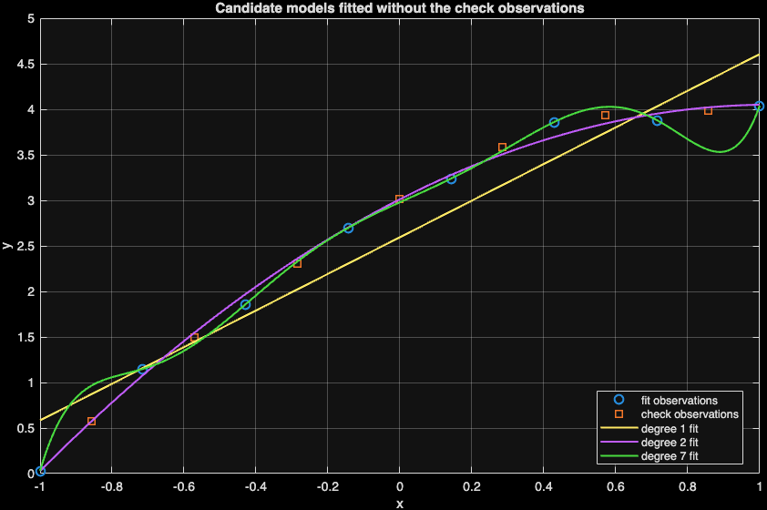
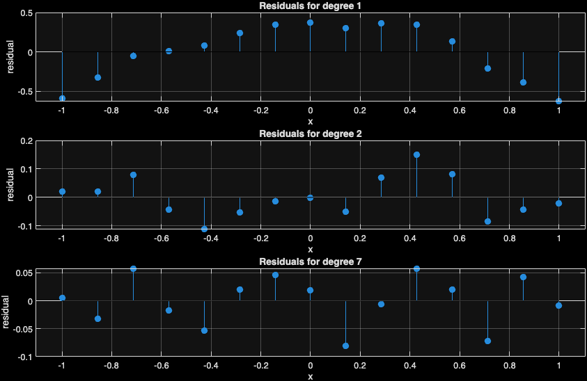
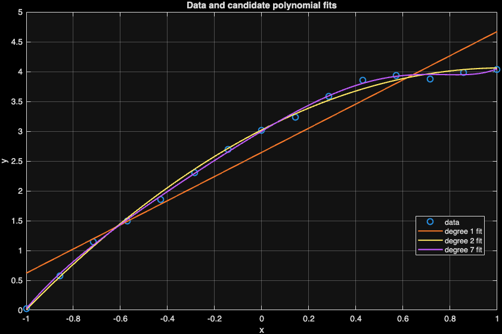
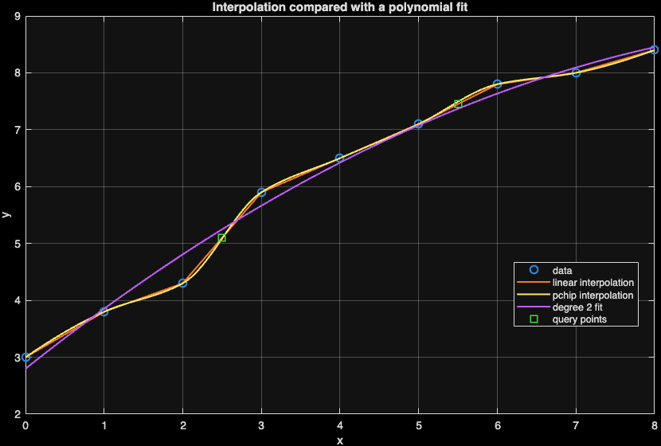
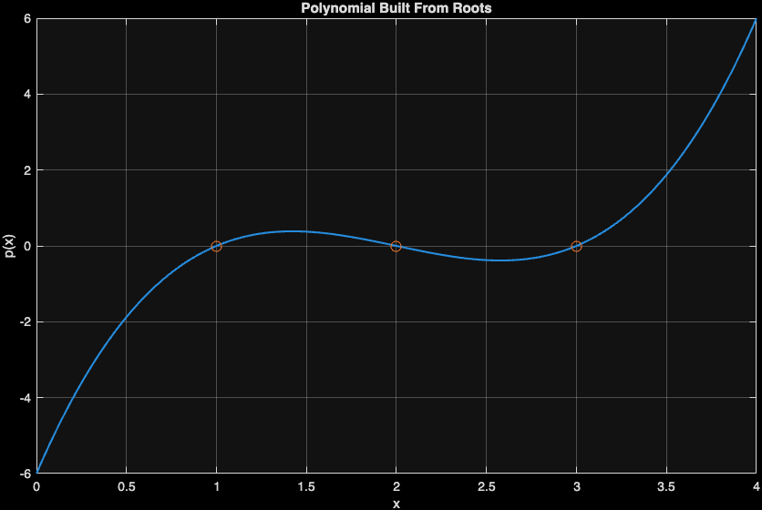
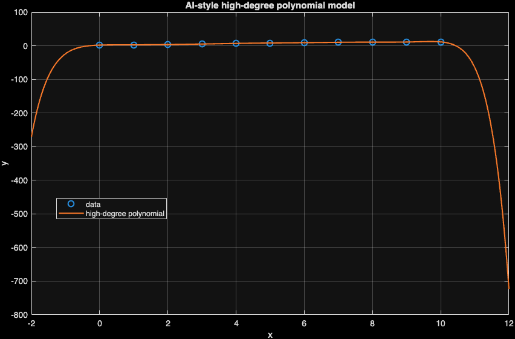

::: {.callout-note}
Use this chapter with the [companion reading guide](how-to-use.html).
**Nothing in this chapter is collected or graded.** The approved syllabus,
workload guide and Blackboard remain authoritative.
:::

## Your route {#route}

**Are we estimating between measurements, describing a trend, or making an extrapolation claim?**

The same data can answer different questions. Interpolation estimates
between trusted measurements; fitting describes an approximate relationship;
extrapolation goes beyond the observed range and needs separate justification.

A smooth curve and a small error on fitted observations can be persuasive but
misleading. We preserve the purpose of the model, inspect residuals and use a
fixed set of observations withheld before fitting to check candidate behavior.

[Before you start](#before-start) · [Words used here](#words) · [Setup](#setup) ·
[Meeting 1](#meeting-one) · [Meeting 2](#meeting-two) · [AI audit](#ai-audit) ·
[Practice and resources](#practice) · [Chapter list](chapters.html).
The page contents navigation also links to the sections.

::: {.callout-tip}
## A first 30-minute recovery session

Choose a stopping point within about 30 minutes; continue from there next time.
This is an untested first-pass budget, not a completion promise. 

1. Check prerequisites and setup. If access is blocked, focus on that first.
2. Read coefficient order and trace observed, fitted and residual values in the fit example.
3. Inspect the separate fit/check RMSE table, keeping its two populations distinct.
4. Try the second self-check and select Core 4 or 5 next. Leave the optional utility reference until needed.

Read displayed results when jumping ahead; run complete code in its stated
sequence when returning to your script. The full practice selection is Core
**1, 2, 4, 5, 6**, selective Guided **3**, and optional Extension **none**,
within the **90–120-minute** ordinary-week budget.
:::

### Before you start {#before-start}

Use vector shapes, elementwise arithmetic, plots and functions from Weeks
1–2. Each x value must be paired with its y value. No formal model-validation
workflow or regression theory is assumed; here we call the two subsets fit data
and check observations not used for fitting.

Use [software requirements](https://lnajman.github.io/math346/resources/software-requirements.html) and the
[course glossary](https://lnajman.github.io/math346/resources/glossary.html) when needed. You do not need a
paid AI account or an external AI call: the flawed examples are supplied locally.

::: {.callout-note #words}
## Words used in this chapter

| Word or pattern | Meaning here |
|---|---|
| **Coefficient vector** | Polynomial coefficients in descending powers; zero terms still occupy positions. |
| **Fitted value** | The model’s evaluated value at a given x. |
| **Residual** | Observed minus fitted value for one measurement. |
| **RMSE** | Square root of mean squared errors, in the response’s units. |
| **Interpolation** | Estimate inside the measured x range using the given measurements. |
| **Extrapolation** | Evaluate outside the measured x range. |
| **Overfitting risk** | A flexible fit may follow fitting observations closely but behave poorly elsewhere. |
| **Check observations** | Values reserved before fitting and not used to estimate coefficients. |
:::

### Read / Explain / Check / Interpret

Read the inputs and operations; explain your prediction; check a specific
claim; interpret the result with its domain or units.

Think first; write a private comment only where requested—see the
[prediction guide](how-to-use.html#read-explain-check-interpret).

## Setup {#setup}

Use MATLAB and save the three starters in `week03/`. Every example contains its own supplied numerical vectors. The scripts use different teaching data; do not compare RMSE numbers across them as though they used the same observations.

Download the starters first. Keep these files in your working folder: `week03_curve_fitting_validation.m`; `week03_interpolation_vs_fit.m`; `week03_polynomial_tools.m`.

Possible solutions are separate comparison files linked below.

- [Starter: week03_curve_fitting_validation.m](downloads/week03_curve_fitting_validation.m)
- [Starter: week03_interpolation_vs_fit.m](downloads/week03_interpolation_vs_fit.m)
- [Starter: week03_polynomial_tools.m](downloads/week03_polynomial_tools.m)
- [AI critique target: week03_ai_overfit_review.m](downloads/week03_ai_overfit_review.m)

Run this from your working folder:

```matlab
required_files = {'week03_curve_fitting_validation.m', 'week03_interpolation_vs_fit.m', 'week03_polynomial_tools.m'};
for file_index = 1:numel(required_files)
    if isfile(required_files{file_index})
        fprintf("Found: %s\n", required_files{file_index});
    else
        fprintf("Missing: %s\n", required_files{file_index});
    end
end
```

Fix any missing path before continuing. Each reference below is a complete
script: save/run it as its own `.m` file, rather than combining several scripts
and local-function definitions in one file. The `clear` lines deliberately
rebuild each example independently. MATLAB `assert` is silent when its condition
passes and stops when it fails. Read the error and inspect the input; do not
weaken a check merely to finish the run.

## Meeting 1 · Read the computation {#meeting-one}

Class route: two 75-minute meetings, each with its final five-minute exit.

In p=[2 0 -3 1], the leading coefficient multiplies x³ and the zero
keeps the missing x² term in place. polyval evaluates coefficients; polyfit
estimates them from paired observations. Read yhat and y in the same order and
shape before subtracting. Otherwise a matrix of pairwise differences can replace
the intended one residual per observation.

### Read fitted values and residual evidence {#stage-1}

**Slide cues:** *Polynomial Vectors*; *Why Zeros Matter*; *Curve Fitting Pattern*; *Residuals*; *RMSE*; *Hold Back Check Observations*; *Compare Two Errors*.

The reference first fits degrees 1, 2 and 7 to all fifteen supplied
observations. It evaluates each fit at the observed x values, computes
observed-minus-fitted residuals and plots their patterns. RMSE condenses squared
residuals but does not retain where a pattern occurs.

The section labelled Meeting 2 then defines alternating fit/check indices
before refitting. Only x(fit_idx),y(fit_idx) estimate coefficients. The
withheld predictions are evaluated without refitting, and fit/check RMSE are
reported separately. During Meeting 1, stop at the Meeting 2 comment; return
to the complete script for Meeting 2. The first all-data table is not the later
fit-subset table.

**Predict in a private comment first:** Can the highest degree have the smallest fit RMSE but a larger check RMSE? Would a residual pattern be visible from RMSE alone?

<details>
<summary>Compare your reasoning</summary>

Yes: the degree-7 fit nearly interpolates its fitting observations, but
degree 2 performs better on the fixed check observations in this supplied case.
RMSE alone does not show a residual’s location or pattern. If your answer
differed, distinguish closeness on fitted data from behavior on withheld data.

</details>

**Try before expanding:** Use Core 1/2/4 to read coefficients and compute a first residual vector before opening the reference. Predict its shape and calculate one residual by hand.

<details>
<summary>Reference version · week03_curve_fitting_validation_sol.m</summary>

**Meeting 1 stopping point:** this supplied script contains both meetings. For Meeting 1, stop at the comment `%% Meeting 2`; leave the fixed holdout comparison below it for Meeting 2.

```matlab
% MATH 346 - Week 3
% Possible worked solution - compare only after attempting the starter.
% Other correct implementations are possible.
% Compare polynomial fits with residual checks

clear; clc; close all;

x = linspace(-1, 1, 15);
y = [0.03 0.58 1.15 1.50 1.86 2.31 2.70 3.02 3.24 3.59 ...
     3.86 3.94 3.88 3.99 4.04];

degrees = [1 2 7];
x_fine = linspace(min(x), max(x), 300);

rmse_values = zeros(size(degrees));
residual_store = zeros(numel(degrees), numel(x));
legend_entries = {"data"};

figure;
plot(x, y, "o", "MarkerSize", 7, "LineWidth", 1.5);
hold on;

for k = 1:numel(degrees)
    degree = degrees(k);
    p = polyfit(x, y, degree);

    yhat = polyval(p, x);
    residuals = y - yhat;
    rmse_values(k) = sqrt(mean(residuals.^2));
    residual_store(k, :) = residuals;

    y_fine = polyval(p, x_fine);
    plot(x_fine, y_fine, "LineWidth", 1.5);
    legend_entries{end + 1} = sprintf("degree %d fit", degree);
end

hold off;
grid on;
xlabel("x");
ylabel("y");
title("Data and candidate polynomial fits");
legend(legend_entries, "Location", "best");

figure;
for k = 1:numel(degrees)
    subplot(numel(degrees), 1, k);
    stem(x, residual_store(k, :), "filled");
    hold on;
    plot([min(x), max(x)], [0, 0], "k-");
    hold off;
    grid on;
    xlabel("x");
    ylabel("residual");
    title(sprintf("Residuals for degree %d", degrees(k)));
end

rmse_table = table(degrees(:), rmse_values(:), ...
    'VariableNames', {'Degree', 'RMSE'});

disp(rmse_table);

fprintf("Smallest RMSE is not the only model-selection rule.\n");
fprintf("Use the residual plots and the purpose of the model too.\n");

%% Meeting 2: check on observations not used for fitting
fit_idx = 1:2:numel(x);
check_idx = 2:2:numel(x);

fit_rmse_values = zeros(size(degrees));
check_rmse_values = zeros(size(degrees));
legend_entries = {"fit observations", "check observations"};

figure;
plot(x(fit_idx), y(fit_idx), "o", "MarkerSize", 7, "LineWidth", 1.5);
hold on;
plot(x(check_idx), y(check_idx), "s", "MarkerSize", 7, "LineWidth", 1.5);

for k = 1:numel(degrees)
    degree = degrees(k);
    p = polyfit(x(fit_idx), y(fit_idx), degree);

    fit_predictions = polyval(p, x(fit_idx));
    check_predictions = polyval(p, x(check_idx));
    fit_rmse_values(k) = sqrt(mean((y(fit_idx) - fit_predictions).^2));
    check_rmse_values(k) = sqrt(mean((y(check_idx) - check_predictions).^2));

    plot(x_fine, polyval(p, x_fine), "LineWidth", 1.5);
    legend_entries{end + 1} = sprintf("degree %d fit", degree);
end

hold off;
grid on;
xlabel("x");
ylabel("y");
title("Candidate models fitted without the check observations");
legend(legend_entries, "Location", "best");

check_table = table(degrees(:), fit_rmse_values(:), check_rmse_values(:), ...
    'VariableNames', {'Degree', 'FitRMSE', 'CheckRMSE'});
disp(check_table);

[~, best_fit_index] = min(fit_rmse_values);
[~, best_check_index] = min(check_rmse_values);
fprintf("Smallest fit RMSE: degree %d.\n", degrees(best_fit_index));
fprintf("Smallest check RMSE: degree %d.\n", degrees(best_check_index));
fprintf("Check observations were not used to estimate any coefficients.\n");
```

**Output from the checked MATLAB run:**

```text
Degree      RMSE  
    ______    ________

      1        0.34116
      2       0.068853
      7       0.043003

Smallest RMSE is not the only model-selection rule.
Use the residual plots and the purpose of the model too.
    Degree     FitRMSE      CheckRMSE
    ______    __________    _________

      1          0.37262     0.31063 
      2         0.080219    0.055598 
      7       4.4199e-15     0.22542 

Smallest fit RMSE: degree 7.
Smallest check RMSE: degree 2.
Check observations were not used to estimate any coefficients.
```

{width=85%}

{width=85%}

{width=85%}

</details>

**Explain / Check / Interpret:** The fixed-split table is about 0.373/0.311 for degree 1 and 0.080/0.056
for degree 2 (fit/check RMSE). Degree 7 has approximately zero fit error but
about 0.225 check error. These values belong to this script and split, not to
the other scripts’ different datasets. One split is stronger evidence than fit
residuals alone, with a limited conclusion about future behavior.

### Meeting 1 in-class exit · Final five minutes

What evidence makes a fit believable?

Solo readers: use the self-check below; no submission.

### Meeting 1 self-check · No submission

For the fit-evidence activity, explain why a small RMSE and a
curved residual pattern can coexist. Which information did the scalar RMSE
remove?

<details>
<summary>Compare the Meeting 1 self-check</summary>

RMSE aggregates squared errors into one scale and omits where each error
occurred. A residual plot retains location and can show a systematic missed
shape even when the average error is small. Neither alone establishes behavior
on observations not used for fitting.

</details>

## Meeting 2 · Check the claim {#meeting-two}

A tiny fit error is evidence about the observations used to estimate the
coefficients. To check behavior on observations not used for fitting, declare
one split before fitting and use it consistently for every candidate degree.
A small check set is useful evidence, but repeatedly redesigning a model to
make it win on that set weakens the check.

### Choose the question before an interpolation method {#stage-2}

**Slide cues:** *Interpolation Pattern*; *Interpolation Input Check*; *Method Choice*; *Interpolation Or Fit?*; *Extrapolation*.

The script compares linear and shape-preserving pchip interpolation with
a quadratic fit at x=2.5 and 5.5. Both query points lie inside [0,8]. Linear
interpolation joins neighboring observations; the fitted polynomial need not
pass through every measured point. Smoothness alone is not a selection rule.

Before using your own queries, check sorted, distinct x values and require
queries within the intended measured range. Outside the range the question
becomes extrapolation. MATLAB may return missing or extrapolated values depending
on the explicit call options; do not let an option silently choose the claim.

**Predict · Think first:** For trusted measurements at x=2 and x=3 with y=4.3 and y=5.9, what is the linear interpolated value at 2.5? Would querying x=12 be the same question?

<details>
<summary>Compare your reasoning</summary>

The midpoint estimate is (4.3+5.9)/2=5.1. x=12 is outside [0,8] and is
an extrapolation claim. If your answer differed, locate the neighboring measured
points and the query range before choosing a method.

</details>

**Try before expanding:** Use Core 5 to check the supplied time/query ranges before choosing linear or pchip. Work out one linear estimate independently before expanding.

<details>
<summary>Reference version · week03_interpolation_vs_fit_sol.m</summary>

```matlab
% MATH 346 - Week 3
% Possible worked solution - compare only after attempting the starter.
% Other correct implementations are possible.
% Compare interpolation with polynomial fitting

clear; clc; close all;

x = [0 1 2 3 4 5 6 7 8];
y = [3.0 3.8 4.3 5.9 6.5 7.1 7.8 8.0 8.4];

x_query = [2.5 5.5];

y_linear = interp1(x, y, x_query, "linear");
y_pchip = interp1(x, y, x_query, "pchip");

p2 = polyfit(x, y, 2);
y_fit_query = polyval(p2, x_query);

for k = 1:numel(x_query)
    fprintf("x = %.1f: linear = %.3f, pchip = %.3f, degree 2 fit = %.3f\n", ...
        x_query(k), y_linear(k), y_pchip(k), y_fit_query(k));
end

x_fine = linspace(min(x), max(x), 300);
y_linear_curve = interp1(x, y, x_fine, "linear");
y_pchip_curve = interp1(x, y, x_fine, "pchip");
y_fit_curve = polyval(p2, x_fine);

figure;
plot(x, y, "o", "MarkerSize", 7, "LineWidth", 1.5);
hold on;
plot(x_fine, y_linear_curve, "LineWidth", 1.5);
plot(x_fine, y_pchip_curve, "LineWidth", 1.5);
plot(x_fine, y_fit_curve, "LineWidth", 1.5);
plot(x_query, y_linear, "s", "MarkerSize", 8, "LineWidth", 1.5);
hold off;
grid on;
xlabel("x");
ylabel("y");
title("Interpolation compared with a polynomial fit");
legend("data", "linear interpolation", "pchip interpolation", ...
    "degree 2 fit", "query points", "Location", "best");

fprintf("\nThe query points are inside the measured range.\n");
fprintf("For x-values outside this range, the question becomes extrapolation.\n");
```

**Output from the checked MATLAB run:**

```text
x = 2.5: linear = 5.100, pchip = 5.086, degree 2 fit = 5.249
x = 5.5: linear = 7.450, pchip = 7.492, degree 2 fit = 7.369

The query points are inside the measured range.
For x-values outside this range, the question becomes extrapolation.
```

{width=85%}

</details>

**Explain / Check / Interpret:** The reference prints both query results and overlays the three curves.
Passing through observations is appropriate for interpolation when those values
are trusted; it is not by itself evidence of a good model of noisy measurements.
Keep method, measured range and the intended meaning of the estimate together.

### Guided reference: roots, factors and derivatives {#stage-3}

**Slide cues:** *Polynomial Utility Tools*; *Polynomial Factors*.

This is Guided Exercise 3 support. poly turns the roots 1,2,3 into a
coefficient vector, roots goes in the reverse direction, and conv multiplies
coefficient vectors for factors. The norm comparison checks the constructed
coefficients rather than requiring a particular order of numerically returned
roots. polyder differentiates a coefficient vector, not sampled y values.

**Predict · Think first:** Does poly expect a list of roots or sampled function values? Why compare coefficient vectors built by two methods?

<details>
<summary>Compare your reasoning</summary>

poly takes roots here; polyfit instead takes paired observations and a
degree. Independent factor multiplication should give the same coefficients.
If your answer differed, inspect function inputs instead of inferring the job
from the similar names poly, polyval and polyfit.

</details>

**Try before expanding:** If Guided 3 was selected or you need coefficient recovery, predict the degree and constant term before opening. Otherwise keep this reference available and continue to core practice.

<details>
<summary>Reference version · week03_polynomial_tools_sol.m</summary>

```matlab
% MATH 346 - Week 3
% Possible worked solution - compare only after attempting the starter.
% Other correct implementations are possible.
% Polynomial utility commands and checks

clear; clc; close all;

roots_expected = [1 2 3];
p = poly(roots_expected);
roots_computed = roots(p);

disp("Coefficients built from roots 1, 2, and 3:");
disp(p);

disp("Roots recovered from the coefficient vector:");
disp(roots_computed.');

factor1 = [1 -1];
factor2 = [1 -2];
factor3 = [1 -3];
p_from_factors = conv(conv(factor1, factor2), factor3);

assert(norm(p - p_from_factors) < 1e-12);

dp = polyder(p);
slope_at_2 = polyval(dp, 2);

fprintf("Derivative coefficients:\n");
disp(dp);
fprintf("Derivative evaluated at x = 2: %.3f\n", slope_at_2);

x = linspace(0, 4, 200);
y = polyval(p, x);

figure;
plot(x, y, "LineWidth", 1.5);
hold on;
plot(roots_expected, zeros(size(roots_expected)), "o", "MarkerSize", 8);
grid on;
xlabel("x");
ylabel("p(x)");
title("Polynomial Built From Roots");
```

**Output from the checked MATLAB run:**

```text
Coefficients built from roots 1, 2, and 3:
     1    -6    11    -6

Roots recovered from the coefficient vector:
    3.0000    2.0000    1.0000

Derivative coefficients:
     3   -12    11

Derivative evaluated at x = 2: -1.000
```

{width=85%}

</details>

**Explain / Check / Interpret:** The script checks agreement within 1e-12, then prints derivative
coefficients and the slope at x=2. That slope is -1 for the polynomial built
from roots 1,2,3. Approximate numerical root order may vary; compare the intended
mathematical set rather than requiring an accidental display order.

## AI audit · Inspect before accepting {#ai-audit}

**Slide cues:** *Plausible But Weak AI Code*; *AI Check*.

This section supports **Core 6**. Use its code-reading and checking
steps for that exercise. The full AI-review lab is used only when selected.

Read the supplied target and choose a check before opening the diagnosis.
No AI service is contacted.

The target picks degree length(x)-1 and evaluates at x=12. Before accepting
“best”, check the observed x range, degree rationale, residuals and whether any
observations were reserved before fitting. A polished curve is not one of those
independent checks.

**Reading excerpt:** this fragment relies on the supplied script setup; inspect it here, then run the complete file in the evidence reveal.

```matlab
clear; clc; close all;

x = [0 1 2 3 4 5 6 7 8 9 10];
y = [2.0 2.8 3.6 5.1 6.9 8.2 9.1 10.2 10.7 11.1 11.4];

degree = length(x) - 1;
p = polyfit(x, y, degree);

x_plot = linspace(min(x) - 2, max(x) + 2, 500);
y_plot = polyval(p, x_plot);

figure;
plot(x, y, "o", "MarkerSize", 7, "LineWidth", 1.5);
hold on;
plot(x_plot, y_plot, "LineWidth", 1.5);
hold off;
grid on;
xlabel("x");
ylabel("y");
title("AI-style high-degree polynomial model");
legend("data", "high-degree polynomial", "Location", "best");

x_future = 12;
y_future = polyval(p, x_future);

fprintf("Generated-code claim:\n");
fprintf("The best polynomial predicts y = %.3f when x = %.1f.\n", ...
    y_future, x_future);
```


**Predict in a private comment first:** What is hidden in the choice of maximum degree and the x=12 prediction? Which stronger comparison would you make?

<details>
<summary>Compare your reasoning</summary>

The maximum degree closely follows fitted observations and x=12 lies
outside the target script’s observed [0,10] range. Compare a simpler degree,
residual patterns and fixed withheld observations, then qualify or refuse the
extrapolation according to the question. If your answer differed, distinguish
a small fitting error from evidence for a future-value claim.

</details>

<details>
<summary>Run the complete supplied critique target and inspect the evidence</summary>

```matlab
% MATH 346 - Week 3
% AI overfitting critique starter
%
% This script intentionally imitates plausible but weak generated code.
% Your job is to review the modeling claim before trusting it.

clear; clc; close all;

x = [0 1 2 3 4 5 6 7 8 9 10];
y = [2.0 2.8 3.6 5.1 6.9 8.2 9.1 10.2 10.7 11.1 11.4];

degree = length(x) - 1;
p = polyfit(x, y, degree);

x_plot = linspace(min(x) - 2, max(x) + 2, 500);
y_plot = polyval(p, x_plot);

figure;
plot(x, y, "o", "MarkerSize", 7, "LineWidth", 1.5);
hold on;
plot(x_plot, y_plot, "LineWidth", 1.5);
hold off;
grid on;
xlabel("x");
ylabel("y");
title("AI-style high-degree polynomial model");
legend("data", "high-degree polynomial", "Location", "best");

x_future = 12;
y_future = polyval(p, x_future);

fprintf("Generated-code claim:\n");
fprintf("The best polynomial predicts y = %.3f when x = %.1f.\n", ...
    y_future, x_future);

% Review questions:
% 1. Is this interpolation, curve fitting, or extrapolation?
% 2. What degree did the code choose, and why?
% 3. Does the plot justify the word "best"?
% 4. Add residuals and compare this model with degree 2.
% 5. Were any observations kept out of fitting to provide a new-data check?
```

**Output from the checked MATLAB run:**

```text
Generated-code claim:
The best polynomial predicts y = -723.200 when x = 12.0.
```

{width=85%}

</details>

Use the existing AI policy when assistance is used: explain every accepted line
and keep the requested evidence with your existing work. A passing test never
replaces checking whether the code answers the actual question.

### Meeting 2 in-class exit · Final five minutes

A degree-7 polynomial has the smallest RMSE on the observations used to fit it.

Why is that insufficient evidence that it is the best model, and what check
would provide stronger evidence?

Solo readers: use the self-check below; no submission.

### Meeting 2 self-check · No submission

Close earlier reveals and explain from memory: Two candidates use different withheld observations and one has the smaller
reported check RMSE. Is that a clean comparison of degrees? What should be fixed
before fitting?

<details>
<summary>Compare the Meeting 2 self-check</summary>

No. The candidates were checked on different cases. Declare one fit/check
split and evaluate all candidates against it without using those check values
to estimate coefficients. Keep both errors and the small-check-set limitation
visible; do not search repeatedly for a favorable split.

</details>

## Practice, recovery and resources {#practice}

**Core:** 1, 2, 4, 5, 6. **Guided:** 3. **Extension:** none.

Core 1/2 read and evaluate polynomials; Core 4 fits and checks residuals;
Core 5 interpolates within a range; Core 6 audits complexity and extrapolation.
Polynomial utilities remain Guided 3. 

Attempt the selected starter blocks before comparing possible solutions.
TODO comments are placeholders, not completed analysis. Keep your checked script
and follow Blackboard if a checkpoint is requested.

**If you are stuck:** inspect coefficient order, paired x/y shapes, query range, and the fixed fit/check split. Run missing definitions
before their first use. Keep the first error and ask for help if a focused
attempt remains blocked.

- [Possible solution: week03_curve_fitting_validation_sol.m](downloads/solutions/week03_curve_fitting_validation_sol.m)
- [Possible solution: week03_interpolation_vs_fit_sol.m](downloads/solutions/week03_interpolation_vs_fit_sol.m)
- [Possible solution: week03_polynomial_tools_sol.m](downloads/solutions/week03_polynomial_tools_sol.m)

**Where this fits:** [Week 3 notes](https://lnajman.github.io/math346/weeks/week-03.html) ·
[Matching slides](https://lnajman.github.io/math346/slides/week-03.html) ·
[Main lab](https://lnajman.github.io/math346/labs/lab-03-fitting-validation.html) ·
[AI-review lab](https://lnajman.github.io/math346/labs/lab-03-ai-overfit.html) ·
[Exercises](https://lnajman.github.io/math346/weeks/week-03-exercises.html).

