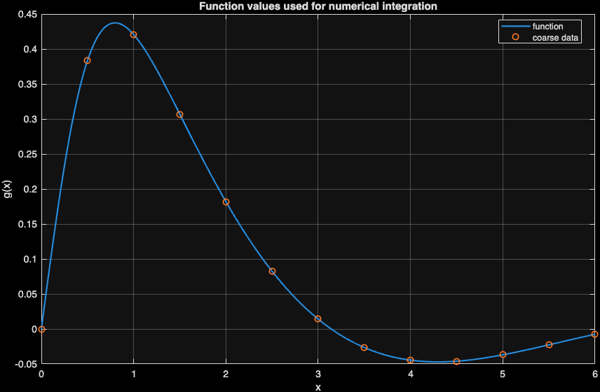
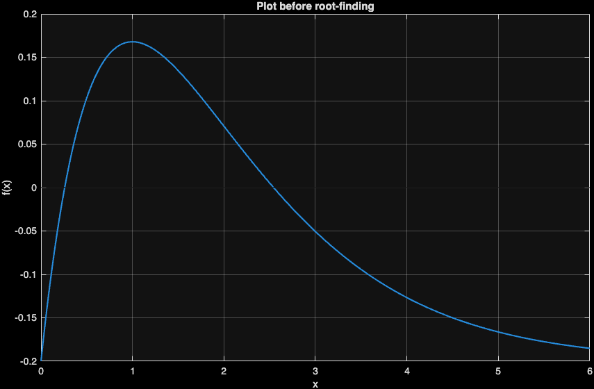
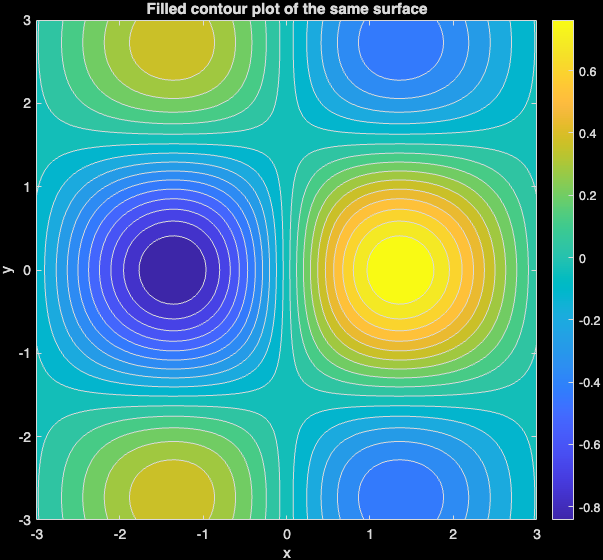
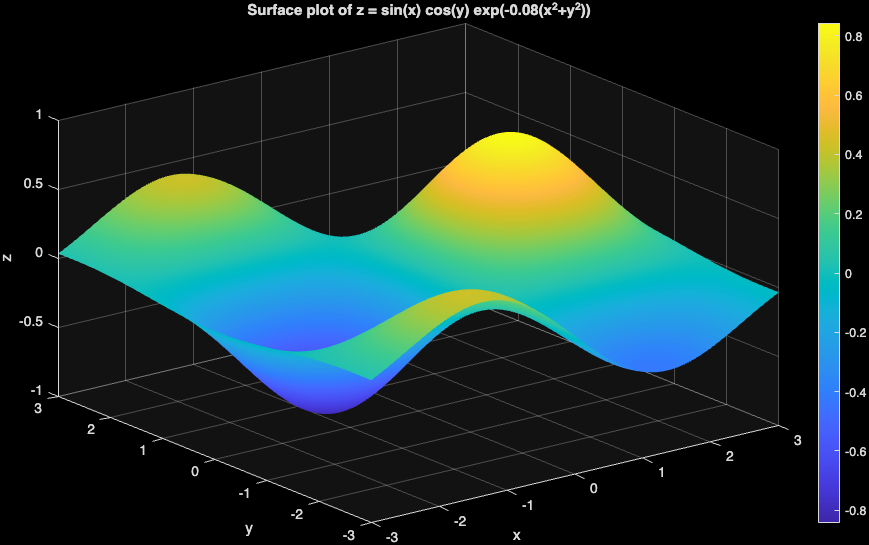
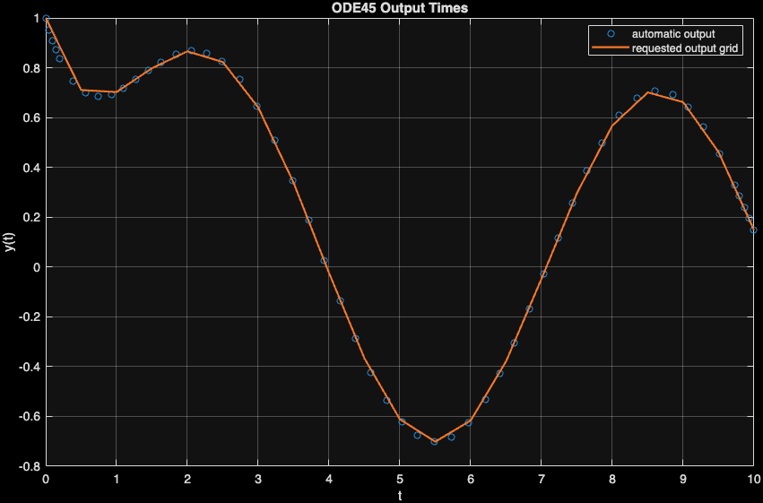
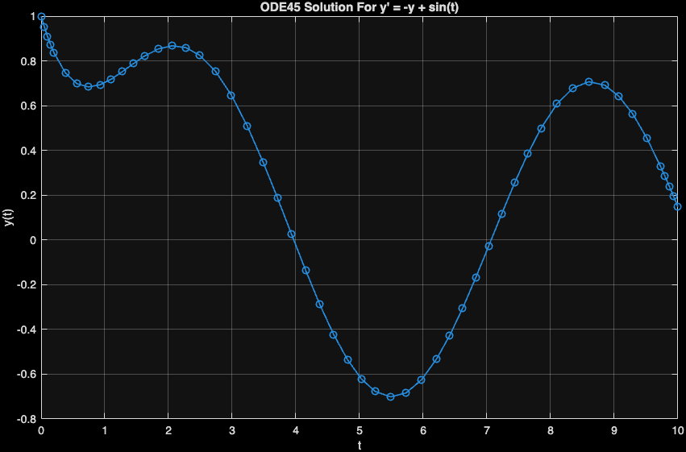

::: {.callout-note}
Use this chapter with the [companion reading guide](how-to-use.html).
**Nothing in this chapter is collected or graded.** The approved syllabus,
workload guide and Blackboard remain authoritative.
:::

## Your route {#route}

**What makes an approximate answer credible beyond its printed digits?**

Numerical methods need a mathematical problem and a declared interval,
bracket, initial condition or grid. We inspect a function, find and check roots,
compare function-based and sampled-data integrals, then view a surface from
more than one direction.

The original ODE example remains available as extension or alternate support.
A generated number is a claim to investigate: one solver call can return one
valid root without showing every relevant root.

[Before you start](#before-start) · [Words used here](#words) · [Setup](#setup) ·
[Meeting 1](#meeting-one) · [Meeting 2](#meeting-two) · [AI audit](#ai-audit) ·
[Practice and resources](#practice) · [Chapter list](chapters.html).
The page contents navigation also links to the sections.

::: {.callout-tip}
## A first 30-minute recovery session

Choose a stopping point within about 30 minutes; continue from there next time.
This is an untested first-pass budget, not a completion promise. **Scope:** the ODE reference is optional/alternate support; leave it out of the short route unless selected.

1. Check prerequisites and setup. If access is blocked, focus on that first.
2. Inspect the root function, its two brackets and its residual table.
3. Read the integration comparison and identify which estimate uses sampled data.
4. Try the second self-check and choose Core 2, 4 or 7 next; leave the optional ODE section for later.

Read displayed results when jumping ahead; run complete code in its stated
sequence when returning to your script. The full practice selection is Core
**1, 2, 4, 7, 8**, selective Guided **3**, and optional Extension **5, 6**,
within the **90–120-minute** ordinary-week budget.
:::

### Before you start {#before-start}

You should read function handles, elementwise operations, plots and basic
residuals from Weeks 1–3. No symbolic toolbox is required. The main workflow uses
built-in MATLAB numerical functions. The ODE mini-lab is an extension/alternate
route, not a second full lab automatically assigned.

Use [software requirements](https://lnajman.github.io/math346/resources/software-requirements.html) and the
[course glossary](https://lnajman.github.io/math346/resources/glossary.html) when needed. You do not need a
paid AI account or an external AI call: the flawed examples are supplied locally.

::: {.callout-note #words}
## Words used in this chapter

| Word or pattern | Meaning here |
|---|---|
| **Root** | An x where f(x)=0. |
| **Bracket** | An interval with suitable sign change used to locate a root of a continuous function. |
| **Residual** | f(root), the remaining equation discrepancy. |
| **Tolerance** | A requested numerical stopping or comparison scale. |
| **Sample spacing** | Distance between the x values used in a sampled-data approximation. |
| **Local minimum** | A value minimal nearby; global claims require more evidence. |
| **Grid** | Sampled coordinate locations used to evaluate a surface. |
| **Contour** | A line or band showing equal surface heights from above. |
| **Initial-value problem** | A derivative rule, starting time/value and interval. |
:::

### Read / Explain / Check / Interpret

Read the inputs and operations; explain your prediction; check a specific
claim; interpret the result with its domain or units.

Think first; write a private comment only where requested—see the
[prediction guide](how-to-use.html#read-explain-check-interpret).

## Setup {#setup}

Use MATLAB in a `week04` folder. The numerical and surface scripts use no external files. The ODE reference is included only for the extension/alternate route.

Download the starters first. Keep these files in your working folder: `week04_root_integration_checks.m`; `week04_surface_contour_visualization.m`; `week04_ode_solver_check.m`.

Possible solutions are separate comparison files linked below.

- [Starter: week04_root_integration_checks.m](downloads/week04_root_integration_checks.m)
- [Starter: week04_surface_contour_visualization.m](downloads/week04_surface_contour_visualization.m)
- [Starter: week04_ode_solver_check.m](downloads/week04_ode_solver_check.m)
- [AI critique target: week04_ai_numeric_review.m](downloads/week04_ai_numeric_review.m)

Run this from your working folder:

```matlab
required_files = {'week04_root_integration_checks.m', 'week04_surface_contour_visualization.m', 'week04_ode_solver_check.m'};
for file_index = 1:numel(required_files)
    if isfile(required_files{file_index})
        fprintf("Found: %s\n", required_files{file_index});
    else
        fprintf("Missing: %s\n", required_files{file_index});
    end
end
```

Fix any missing path before continuing. Each reference below is a complete
script: save/run it as its own `.m` file, rather than combining several scripts
and local-function definitions in one file. The `clear` lines deliberately
rebuild each example independently. MATLAB `assert` is silent when its condition
passes and stops when it fails. Read the error and inspect the input; do not
weaken a check merely to finish the run.

## Meeting 1 · Read the computation {#meeting-one}

Class route: two 75-minute meetings, each with its final five-minute exit.

First write the equation as f(x)=0. A small f(root) is a residual check of
the equation, not a search for all roots. A bracket restricts the solver’s
search, while a plot helps choose brackets and spot other crossings. The
number is incomplete without the function, method, search interval and check.

### Roots and two kinds of integral input {#stage-1}

**Slide cues:** *Root-Finding Pattern*; *One Root Or All Roots?*; *Numerical Integration*; *Data-Based Integration*; *Comparison Habit*.

The function x*exp(-x)-0.2 has two inspected crossings, searched using
[0,1] and [1,5]. The second output from fzero is the function value at its
returned root, printed alongside the bracket. Substitute the root directly as
a second reading check of what that output means.

For integration, integral receives a function handle on [0,6]; trapz receives
sampled x/y pairs. The script compares 13 points with 201 points against the
function-based estimate. These are numerical comparisons, not an exact-error
certificate. The final fminbnd line is recognition support for Extension 6;
its printed “local minimum on [0,4]” should retain that qualification.

**Predict in a private comment first:** If both residuals are tiny, have we shown the two brackets contain credible roots or that no root exists anywhere else? What input changes between coarse and fine trapz?

<details>
<summary>Compare your reasoning</summary>

The residuals support those computed roots; they do not prove there are
no others. The sampled grids change from 13 to 201 points on the same interval.
If your answer differed, separate checking a candidate from finding all
candidates and distinguish sampled data from a supplied function.

</details>

**Try before expanding:** Use Core 1/2 to form and bracket your equation, then Core 4 to compare integration inputs before expanding the reference.

<details>
<summary>Reference version · week04_root_integration_checks_sol.m</summary>

```matlab
% MATH 346 - Week 4
% Possible worked solution - compare only after attempting the starter.
% Other correct implementations are possible.
% Numerical roots, integration, and validation checks

clear; clc; close all;

f = @(x) x.*exp(-x) - 0.2;
x_grid = linspace(0, 6, 500);
y_grid = f(x_grid);

figure;
plot(x_grid, y_grid, "LineWidth", 1.5);
hold on;
plot([min(x_grid), max(x_grid)], [0, 0], "k-");
hold off;
grid on;
xlabel("x");
ylabel("f(x)");
title("Plot before root-finding");

[left_root, left_residual] = fzero(f, [0 1]);
[right_root, right_residual] = fzero(f, [1 5]);

Root = [left_root; right_root];
Residual = [left_residual; right_residual];
Bracket = {'[0, 1]'; '[1, 5]'};
disp(table(Bracket, Root, Residual));

fprintf("A root is credible only after checking f(root).\n\n");

g = @(x) sin(x)./(1 + x.^2);

area_function = integral(g, 0, 6);

x_coarse = linspace(0, 6, 13);
y_coarse = g(x_coarse);
area_trapz_coarse = trapz(x_coarse, y_coarse);

x_fine = linspace(0, 6, 201);
y_fine = g(x_fine);
area_trapz_fine = trapz(x_fine, y_fine);

Method = {'integral'; 'trapz, 13 points'; 'trapz, 201 points'};
Estimate = [area_function; area_trapz_coarse; area_trapz_fine];
DifferenceFromIntegral = Estimate - area_function;
disp(table(Method, Estimate, DifferenceFromIntegral));

figure;
plot(x_fine, g(x_fine), "LineWidth", 1.5);
hold on;
plot(x_coarse, y_coarse, "o", "MarkerSize", 6, "LineWidth", 1.2);
hold off;
grid on;
xlabel("x");
ylabel("g(x)");
title("Function values used for numerical integration");
legend("function", "coarse data", "Location", "best");

h = @(x) (x - 2).^2 + 0.5*sin(5*x);
[xmin, hmin] = fminbnd(h, 0, 4);
fprintf("Local minimum on [0, 4]: x = %.4f, h(x) = %.4f\n", xmin, hmin);
```

**Output from the checked MATLAB run:**

```text
Bracket       Root      Residual
    __________    _______    ________

    {'[0, 1]'}    0.25917       0    
    {'[1, 5]'}     2.5426       0    

A root is credible only after checking f(root).

           Method            Estimate    DifferenceFromIntegral
    _____________________    ________    ______________________

    {'integral'         }     0.6257                    0      
    {'trapz, 13 points' }    0.60474            -0.020953      
    {'trapz, 201 points'}    0.62562          -7.2878e-05      

Local minimum on [0, 4]: x = 2.1716, h(x) = -0.4658
```

{width=85%}

{width=85%}

</details>

**Explain / Check / Interpret:** Inspect the signed DifferenceFromIntegral and compare absolute differences
when discussing closeness. Finer sampling helps in this supplied smooth case;
monotonic improvement is not a universal theorem for arbitrary data. Record the
brackets and residuals when reporting roots, and state the sample spacing and
reference method when reporting an integration comparison.

### Meeting 1 in-class exit · Final five minutes

Name one numerical check you would not skip.

Solo readers: use the self-check below; no submission.

### Meeting 1 self-check · No submission

For the numerical-evidence activity, an analyst reports a root
with many decimal digits but omits the function value there. What direct check
would you add, and what would it not establish?

<details>
<summary>Compare the Meeting 1 self-check</summary>

Evaluate f(root) and report its residual with the equation and search
interval. A small residual supports that candidate but does not establish it
is the only root or prove all printed digits are meaningful.

</details>

## Meeting 2 · Check the claim {#meeting-two}

A surface is a sampled function on coordinate matrices. meshgrid builds
X/Y of compatible size; elementwise formulas produce Z at each grid point.
A surface gives height and shape but can hide regions behind others. A contour
view shows the same evaluated surface from above. Neither proves an exact
global maximum between or beyond sampled points.

### Read a surface and a contour together {#stage-2}

**Slide cues:** *Surface Workflow*; *Meshgrid Pattern*; *Surface Plot*; *Contour Plot*.

The reference uses 121 values on each axis and evaluates a damped sine/cosine
surface. It demonstrates the plotting pattern; Core 7 changes the formula to
x*exp(-x²-y²) on [-2,2]². Keep the two formulas distinct and update the title
when performing the exercise.

Z(:) flattens the grid for max/min. ind2sub returns the matching row/column
indices, which index X and Y to recover sampled coordinates. Comparing X/Y
shapes and tracing one point helps detect transposed or incompatible arrays.

**Predict · Think first:** Does the largest sampled Z value establish the exact maximum of the mathematical surface? Would changing the viewing angle change Z?

<details>
<summary>Compare your reasoning</summary>

The sampled maximum depends on spacing and the inspected domain. A viewing
angle changes presentation, not the calculated Z array. If your answer differed,
distinguish a display choice from a numerical discretization or a mathematical
optimization claim.

</details>

**Try before expanding:** Use Core 7 to write the elementwise formula and predict grid dimensions before opening the full reference pattern. Choose the surface or contour view that best supports the question.

<details>
<summary>Reference version · week04_surface_contour_visualization_sol.m</summary>

```matlab
% MATH 346 - Week 4
% Possible worked solution - compare only after attempting the starter.
% Other correct implementations are possible.
% Surface and contour visualization checks

clear; clc; close all;

x = linspace(-3, 3, 121);
y = linspace(-3, 3, 121);
[X, Y] = meshgrid(x, y);

Z = sin(X).*cos(Y).*exp(-0.08*(X.^2 + Y.^2));

figure;
surf(X, Y, Z);
shading interp;
colorbar;
grid on;
xlabel("x");
ylabel("y");
zlabel("z");
title("Surface plot of z = sin(x) cos(y) exp(-0.08(x^2+y^2))");

figure;
contourf(X, Y, Z, 20);
colorbar;
axis equal tight;
xlabel("x");
ylabel("y");
title("Filled contour plot of the same surface");

[z_max, max_index] = max(Z(:));
[row, col] = ind2sub(size(Z), max_index);
x_max = X(row, col);
y_max = Y(row, col);

[z_min, min_index] = min(Z(:));
[row_min, col_min] = ind2sub(size(Z), min_index);
x_min = X(row_min, col_min);
y_min = Y(row_min, col_min);

fprintf("Approximate maximum: z = %.4f at x = %.3f, y = %.3f\n", ...
    z_max, x_max, y_max);
fprintf("Approximate minimum: z = %.4f at x = %.3f, y = %.3f\n", ...
    z_min, x_min, y_min);

fprintf("These locations depend on the grid spacing.\n");
```

**Output from the checked MATLAB run:**

```text
Approximate maximum: z = 0.8433 at x = 1.350, y = 0.000
Approximate minimum: z = -0.8433 at x = -1.350, y = 0.000
These locations depend on the grid spacing.
```

{width=85%}

{width=85%}

</details>

**Explain / Check / Interpret:** Both figures describe the same grid and values; compare the color scale,
labels and domain. Report an approximate location rather than more precision
than the grid supports. A labelled colourbar explains what colours encode; an
attractive surface without an interpretable question is weak evidence.

### Optional / alternate: check an ODE initial condition {#stage-3}

**Slide cues:** *ODE Initial-Value Problem*; *ODE Solver Pattern*; *ODE Check*.

Skip this section when it is outside the selected class route. The
initial-value problem is y′=-y+sin(t), y(0)=1 on [0,10]. The derivative handle
takes time and current y; ode45 returns time/solution vectors. The source checks
the first solution value against the stated initial condition.

The second solve asks for 21 output times. Those requested times are where
solutions are returned, not a direct setting of the solver’s internal step
size. More plotted markers alone do not prove better numerical accuracy.

**Predict · Think first:** If y0 becomes zero, which initial-condition value must the first output match? Does requesting 101 output times force 100 equal internal steps?

<details>
<summary>Compare your reasoning</summary>

The first solution must match zero. No: requested output times and
adaptive internal steps are different. If your answer differed, distinguish the
mathematical initial condition from the reporting grid and the solver algorithm.

</details>

**Try before expanding:** If the instructor selected the ODE mini-lab or Extension 5, name f, tspan and y0 before expanding. Otherwise continue to the AI audit or core practice.

<details>
<summary>Reference version · week04_ode_solver_check_sol.m</summary>

```matlab
% MATH 346 - Week 4
% Possible worked solution - compare only after attempting the starter.
% Other correct implementations are possible.
% ODE solver pattern and initial-condition checks

clear; clc; close all;

f = @(t, y) -y + sin(t);
tspan = [0 10];
y0 = 1;

[t, y] = ode45(f, tspan, y0);

initial_error = abs(y(1) - y0);
fprintf("Initial condition error: %.3e\n", initial_error);
assert(initial_error < 1e-12);

figure;
plot(t, y, "o-", "LineWidth", 1.2);
grid on;
xlabel("t");
ylabel("y(t)");
title("ODE45 Solution For y' = -y + sin(t)");

t_requested = linspace(0, 10, 21);
[t_grid, y_grid] = ode45(f, t_requested, y0);

figure;
plot(t, y, "o", "MarkerSize", 5);
hold on;
plot(t_grid, y_grid, "-", "LineWidth", 1.5);
hold off;
grid on;
xlabel("t");
ylabel("y(t)");
title("ODE45 Output Times");
legend("automatic output", "requested output grid", "Location", "best");

fprintf("Final value with automatic output: %.4f\n", y(end));
fprintf("Final value with requested output grid: %.4f\n", y_grid(end));
fprintf("Requested output times do not directly set the solver's internal step size.\n");
```

**Output from the checked MATLAB run:**

```text
Initial condition error: 0.000e+00
Final value with automatic output: 0.1474
Final value with requested output grid: 0.1474
Requested output times do not directly set the solver's internal step size.
```

{width=85%}

{width=85%}

</details>

**Explain / Check / Interpret:** The initial-condition assertion checks the start, not the entire trajectory.
The printed final values provide a consistency comparison. Keep the derivative,
initial value, interval and relevant solver limits in an explanation; changing
y0 defines a different initial-value problem.

## AI audit · Inspect before accepting {#ai-audit}

**Slide cues:** *Plausible But Weak AI Code*; *AI Check*.

This section supports **Core 8**. Use its code-reading and checking
steps for that exercise. The full AI-review lab is used only when selected.

Read the supplied target and choose a check before opening the diagnosis.
No AI service is contacted.

The target solves a cubic from the initial guess zero and prints “the
solution”. Before accepting that phrase, choose a residual check and an
interval/plot search for other crossings. The supplied polynomial factors as
(x-1)(x-2)(x-3), giving a hand-checkable comparison.

**Reading excerpt:** this fragment relies on the supplied script setup; inspect it here, then run the complete file in the evidence reveal.

```matlab
clear; clc; close all;

f = @(x) x.^3 - 6*x.^2 + 11*x - 6;

x0 = 0;
root = fzero(f, x0);

fprintf("Generated-code claim:\n");
fprintf("The solution is x = %.4f.\n", root);
```


**Predict in a private comment first:** Why can the returned root be valid while the claim is incomplete? Which inspected brackets and residuals would strengthen it?

<details>
<summary>Compare your reasoning</summary>

One call can find one root without finding the others. Inspect [0,4],
use separate sign-changing brackets around 1, 2 and 3, and evaluate each
residual. If your answer differed, you may have confused the validity of one
candidate with completeness of the solution set. State the inspected interval
and method limits in the repaired claim.

</details>

<details>
<summary>Run the complete supplied critique target and inspect the evidence</summary>

```matlab
% MATH 346 - Week 4
% AI numerical answer critique starter
%
% This script intentionally imitates plausible but incomplete generated code.
% Your job is to add checks before trusting the printed answer.

clear; clc; close all;

f = @(x) x.^3 - 6*x.^2 + 11*x - 6;

x0 = 0;
root = fzero(f, x0);

fprintf("Generated-code claim:\n");
fprintf("The solution is x = %.4f.\n", root);

% Review questions:
% 1. What initial guess was used?
% 2. Does this prove there is only one solution?
% 3. What is f(root)?
% 4. What does the plot on [0, 4] show?
% 5. Which brackets would find all visible roots?
```

**Output from the checked MATLAB run:**

```text
Generated-code claim:
The solution is x = 1.0000.
```

</details>

Use the existing AI policy when assistance is used: explain every accepted line
and keep the requested evidence with your existing work. A passing test never
replaces checking whether the code answers the actual question.

### Meeting 2 in-class exit · Final five minutes

A numerical answer is trustworthy enough to report when ...

Solo readers: use the self-check below; no submission.

### Meeting 2 self-check · No submission

Close earlier reveals and explain from memory: A 121-by-121 surface grid has a largest sampled value at one location.
What qualification belongs in the report, and what could make the location
estimate change?

<details>
<summary>Compare the Meeting 2 self-check</summary>

Call it an approximate sampled maximum on the stated grid/domain. Changing
spacing or domain can change the estimate; rotating the same plotted data
cannot change the computed maximum. A contour can improve inspection but is
not a proof of the continuous global optimum.

</details>

## Practice, recovery and resources {#practice}

**Core:** 1, 2, 4, 7, 8. **Guided:** 3. **Extension:** 5, 6.

Core 1/2 concern roots and residuals, Core 4 compares integrals, Core 7
builds surface/contour evidence, and Core 8 audits a generated numerical claim.
Multiple-root Exercise 3 is Guided; ODE and local optimization Exercises 5/6
are Extension. 

Attempt the selected starter blocks before comparing possible solutions.
TODO comments are placeholders, not completed analysis. Keep your checked script
and follow Blackboard if a checkpoint is requested.

**If you are stuck:** inspect the function, solver bracket, residual, interval, and sampled grid. Run missing definitions
before their first use. Keep the first error and ask for help if a focused
attempt remains blocked.

- [Possible solution: week04_root_integration_checks_sol.m](downloads/solutions/week04_root_integration_checks_sol.m)
- [Possible solution: week04_surface_contour_visualization_sol.m](downloads/solutions/week04_surface_contour_visualization_sol.m)
- [Possible solution: week04_ode_solver_check_sol.m](downloads/solutions/week04_ode_solver_check_sol.m)

**Where this fits:** [Week 4 notes](https://lnajman.github.io/math346/weeks/week-04.html) ·
[Matching slides](https://lnajman.github.io/math346/slides/week-04.html) ·
[Main lab](https://lnajman.github.io/math346/labs/lab-04-numerical-checks.html) ·
[AI-review lab](https://lnajman.github.io/math346/labs/lab-04-ai-numeric-review.html) ·
[Exercises](https://lnajman.github.io/math346/weeks/week-04-exercises.html).

