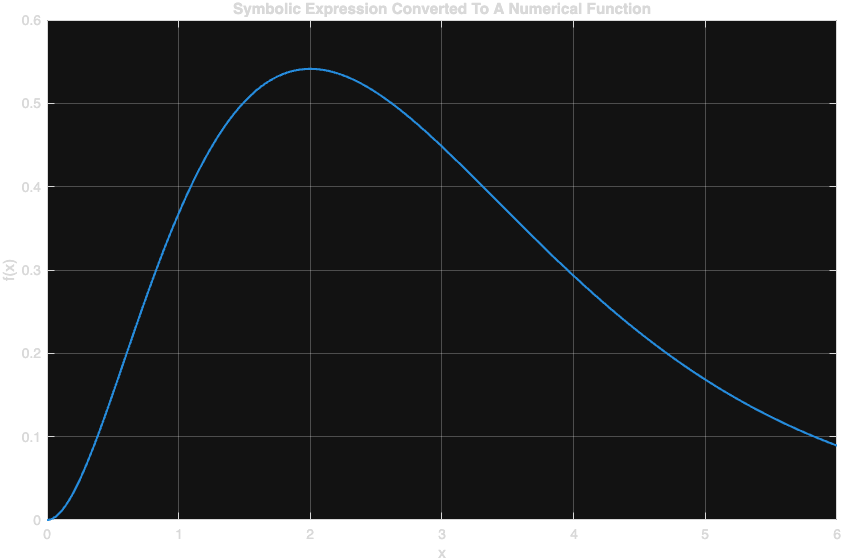
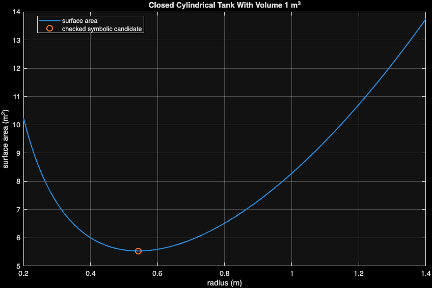

::: {.callout-note}
Use this chapter with the [companion reading guide](how-to-use.html).
**Nothing in this chapter is collected or graded.** The approved syllabus,
workload guide and Blackboard remain authoritative.
:::

## Your route {#route}

**What evidence is needed before a symbolic candidate becomes a defensible solution?**

Exact expressions can preserve structure that a decimal hides. They also
carry assumptions and domain restrictions. We compare exact and finite-decimal
inputs, reverse a calculus operation to check it, and derive a closed-cylinder
tank design before checking it numerically.

The recurring standard is an answer, a specific check, an interpretation and
a relevant limitation. A symbolic solver returning a candidate does not by
itself justify the word “minimum”.

[Before you start](#before-start) · [Words used here](#words) · [Setup](#setup) ·
[Meeting 1](#meeting-one) · [Meeting 2](#meeting-two) · [AI audit](#ai-audit) ·
[Practice and resources](#practice) · [Chapter list](chapters.html).
The page contents navigation also links to the sections.

::: {.callout-tip}
## A first 30-minute recovery session

Choose a stopping point within about 30 minutes; continue from there next time.
This is an untested first-pass budget, not a completion promise. **Access:** running Week 5 requires Symbolic Math Toolbox. Check access first; tracing on paper is still possible, but is not an execution check.

1. Check prerequisites and setup. If access is blocked, focus on that first.
2. Read exact versus decimal input and the role of positive-domain assumptions.
3. Inspect the tank objective, stationarity and curvature checks; distinguish a candidate from the minimum claim.
4. Try the second self-check, then select the next Core 4/7 step. Defer full solver and plotting work if time runs out.

Read displayed results when jumping ahead; run complete code in its stated
sequence when returning to your script. The full practice selection is Core
**1, 4, 6, 7, 9**, selective Guided **2, 3, 5**, and optional Extension **8**,
within the **90–120-minute** ordinary-week budget.
:::

### Before you start {#before-start}

You should recognize function handles, root residuals, numerical integration
and interval-based numerical methods from Weeks 3–4. Symbolic Math Toolbox is
required: run the MATLAB setup check and inspect its separate symbolic
status. If the toolbox is unavailable, you can trace the derivation on paper,
but cannot claim a symbolic execution check.

Use [software requirements](https://lnajman.github.io/math346/resources/software-requirements.html) and the
[course glossary](https://lnajman.github.io/math346/resources/glossary.html) when needed. You do not need a
paid AI account or an external AI call: the flawed examples are supplied locally.

::: {.callout-note #words}
## Words used in this chapter

| Word or pattern | Meaning here |
|---|---|
| **Symbolic object** | An expression manipulated algebraically rather than only evaluated as a floating-point number. |
| **Exact input** | A value such as sym(1)/3 that retains its exact mathematical representation. |
| **Assumption** | A declared restriction such as real or positive. |
| **Admissible domain** | Values allowed by the original mathematical or physical problem. |
| **Residual** | Substitute a candidate into the original equation and measure what remains. |
| **Antiderivative** | A function whose derivative equals the integrand; MATLAB displays one, without + C. |
| **Stationary point** | A point where the derivative is zero; more evidence is needed for a minimum. |
| **Curvature** | The second derivative; positive curvature supports a local minimum. |
| **Boundary behavior** | What happens toward the ends of the admissible domain. |
| **Numerical bridge** | Convert a checked expression to a function handle with matlabFunction. |
:::

### Read / Explain / Check / Interpret

Read the inputs and operations; explain your prediction; check a specific
claim; interpret the result with its domain or units.

Think first; write a private comment only where requested—see the
[prediction guide](how-to-use.html#read-explain-check-interpret).

## Setup {#setup}

Use MATLAB and Symbolic Math Toolbox. Save all three starters in `week05/`. Run each complete reference as its own saved script; no external data or private project package is used in the examples.

Download the starters first. Keep these files in your working folder: `week05_symbolic_numeric_bridge.m`; `week05_symbolic_calculus_checks.m`; `week05_tank_optimization.m`.

Possible solutions are separate comparison files linked below.

- [Starter: week05_symbolic_numeric_bridge.m](downloads/week05_symbolic_numeric_bridge.m)
- [Starter: week05_symbolic_calculus_checks.m](downloads/week05_symbolic_calculus_checks.m)
- [Starter: week05_tank_optimization.m](downloads/week05_tank_optimization.m)
- [AI critique target: week05_ai_symbolic_review.m](downloads/week05_ai_symbolic_review.m)

Run this from your working folder:

```matlab
required_files = {'week05_symbolic_numeric_bridge.m', 'week05_symbolic_calculus_checks.m', 'week05_tank_optimization.m'};
for file_index = 1:numel(required_files)
    if isfile(required_files{file_index})
        fprintf("Found: %s\n", required_files{file_index});
    else
        fprintf("Missing: %s\n", required_files{file_index});
    end
end
```

Fix any missing path before continuing. Each reference below is a complete
script: save/run it as its own `.m` file, rather than combining several scripts
and local-function definitions in one file. The `clear` lines deliberately
rebuild each example independently. MATLAB `assert` is silent when its condition
passes and stops when it fails. Read the error and inspect the input; do not
weaken a check merely to finish the run.

## Meeting 1 · Read the computation {#meeting-one}

Class route: two 75-minute meetings, each with its final five-minute exit.

`1/3` is ordinary floating-point arithmetic. `sym(1)/3` preserves the
exact fraction. A finite decimal approximation to one third differs from that
fraction; printing more digits does not recover the original exact input.
Keep exact values until an approximation is needed for interpretation. The
optional comparison below shows how to express a finite decimal as an exact
fraction. Writing a decimal string alone does not guarantee exact rational
arithmetic. Carry this distinction into the residual checks.

### Exact inputs and domains {#stage-1}

**Slide cues:** *Exact Input Matters*; *State Assumptions*; *Domain Changes The Answer*; *Substitute To Check*.

Read the two “one third” expressions by how they were constructed, not by
how similar the displayed digits look. The script simplifies their difference
and asserts it is not zero. It then solves the real cube-root equation, checks
the exact residual, and compares a high-precision numerical symbolic solve on
[1,2].

The final equations show why assumptions matter: y²=9 has two unrestricted
solutions, while a positive y leaves only 3. The positivity is part of that
second problem, not a universal rule to discard negative roots from every
equation. Use `==` for an equation and `=` for assignment.

**Predict in a private comment first:** Does matching many displayed decimal digits prove the symbolic fraction equals the finite decimal? Which roots remain for a physical positive length satisfying y²=9?

<details>
<summary>Compare your reasoning</summary>

No; the reference subtraction is nonzero. Positivity leaves 3, while -3 is
inadmissible for the positive-length problem. If your answer differed, separate
representation from display precision and algebraic roots from the original
domain.

</details>

**Try before expanding:** For Core 1/6, predict object class and allowed roots before running the saved script. Keep assumptions visible when writing your own first attempt.

<details>
<summary>Reference version · week05_symbolic_numeric_bridge_sol.m</summary>

```matlab
% MATH 346 - Week 5
% Possible worked solution - compare only after attempting the starter.
% Other correct implementations are possible.
% Exact inputs, assumptions, vpa, vpasolve, and residual checks

clear; clc; close all;

exact_one_third = sym(1) / 3;
decimal_one_third = sym("0.3333333333333333");
input_difference = simplify(exact_one_third - decimal_one_third);

disp("Exact one third:");
disp(exact_one_third);
disp("Finite decimal entered symbolically:");
disp(decimal_one_third);
disp("Their exact difference:");
disp(input_difference);
assert(~isAlways(input_difference == 0));

syms x real
root_exact = solve(x^3 == 2, x);
root_decimal = vpa(root_exact, 16);
exact_residual = simplify(root_exact^3 - 2);
assert(isAlways(exact_residual == 0));

root_vpasolve = vpasolve(x^3 == 2, x, [1 2]);
numeric_residual = abs(double(root_vpasolve)^3 - 2);
assert(numeric_residual < 1e-12);

syms y
all_solutions = solve(y^2 == 9, y);

syms y_positive positive
positive_solution = solve(y_positive^2 == 9, y_positive);
assert(numel(all_solutions) == 2);
assert(isAlways(positive_solution == 3));

fprintf("Exact real cube root of 2: %s\n", char(root_exact));
fprintf("Decimal approximation: %s\n", char(root_decimal));
fprintf("vpasolve residual: %.3e\n", numeric_residual);
fprintf("Solutions of y^2 = 9 without a positivity assumption:\n");
disp(all_solutions);
fprintf("Solution when y is assumed positive: %s\n", char(positive_solution));
```

**Output from the checked MATLAB run:**

```text
Exact one third:
1/3
 
Finite decimal entered symbolically:
0.3333333333333333
 
Their exact difference:
0.00000000000000003333333333333333333333340240031
 
Exact real cube root of 2: 2^(1/3)
Decimal approximation: 1.259921049894873
vpasolve residual: 0.000e+00
Solutions of y^2 = 9 without a positivity assumption:
-3
 3
 
Solution when y is assumed positive: 3
```


**Exact rational comparison:** decimal approximations can produce a long trail of rounded digits. To compare the intended finite decimal exactly with one third, write it as an integer fraction. This optional check gives the difference as a fraction too.

[Download the comparison](supplemental/week05_exact_rational_check.m), or run:

```matlab
exact_difference = sym(1)/3 - sym("3333333333333333/10000000000000000");
disp(exact_difference);
assert(isAlways(exact_difference == sym(1)/(3*sym(10)^16)));
```

**Checked output:**

```text
1/30000000000000000
```

</details>

**Explain / Check / Interpret:** The exact and numerical residual checks test the equations under the
stated assumptions. vpasolve’s interval is part of its search; it is not a proof
that no solution exists elsewhere. For Core 9, also preserve restrictions from
the original expression: simplifying (x-1)/(x-1) to 1 must not make x=1 valid.

### Meeting 1 in-class exit · Final five minutes

Complete in 2-3 sentences:

> A symbolic answer is trustworthy enough to report when ...

Solo readers: use the self-check below; no submission.

### Meeting 1 self-check · No submission

For the symbolic-trust activity, explain why an equation can
have a valid negative algebraic root that should not be reported as a tank
radius. Which part of the check comes from the applied question?

<details>
<summary>Compare the Meeting 1 self-check</summary>

Substitution can show the root solves an equation while the physical domain
rejects it. A radius must be positive here. State both the algebraic residual
and admissibility; do not invent a positive-only restriction for an unrelated
problem.

</details>

### Reverse calculus before trusting a result {#stage-2}

**Slide cues:** *Differentiate*; *Integrate*; *Reverse-Operation Check*; *Exact And Numerical Agreement*.

Here `f = x^2 * exp(-x)` is an expression in a symbolic scalar, so this
algebra uses ordinary powers and products. The numerical handle uses `.^` and
`.*` when it accepts a vector. The script differentiates an antiderivative and
simplifies its difference from f to zero; it also compares a definite symbolic
integral on [0,4] with integral on the numerical function.

Substitute a value before converting an expression containing variables to
double. The slope at x=2 is checked at the substitution stage; the expression
itself cannot become a single ordinary number while x remains unspecified.

**Predict · Think first:** If diff(F,x)-f simplifies to zero, what was checked? Does the absence of a displayed + C make F invalid?

<details>
<summary>Compare your reasoning</summary>

It checks that F differentiates to f under the stated domain assumptions.
MATLAB returns one antiderivative; the family is F+C. If your answer differed,
you may have treated one valid representative as an attempt to list the whole
family, or confused the definite integral with an antiderivative.

</details>

**Try before expanding:** Use Core 4 to derive the derivative for the specified exercise function before comparing the reference pattern. Predict the check, not only the displayed answer.

<details>
<summary>Reference version · week05_symbolic_calculus_checks_sol.m</summary>

```matlab
% MATH 346 - Week 5
% Possible worked solution - compare only after attempting the starter.
% Other correct implementations are possible.
% Symbolic differentiation, integration, and independent checks

clear; clc; close all;

syms x real

f = x^2 * exp(-x);
df = diff(f, x);
F = int(f, x);

derivative_check = simplify(diff(F, x) - f);
assert(isAlways(derivative_check == 0));

area_exact = int(f, x, 0, 4);
area_decimal = vpa(area_exact, 12);

f_numeric = @(x) x.^2 .* exp(-x);
area_numeric = integral(f_numeric, 0, 4);
area_difference = abs(double(area_exact) - area_numeric);
assert(area_difference < 1e-10);

x_value = sym(2);
slope_exact = simplify(subs(df, x, x_value));
slope_decimal = double(slope_exact);

disp("Function:");
disp(f);
disp("Derivative:");
disp(df);
disp("One antiderivative (without an arbitrary constant):");
disp(F);
disp("Exact integral from 0 to 4:");
disp(area_exact);

fprintf("Integral, 12 significant digits: %s\n", char(area_decimal));
fprintf("Independent numerical integral: %.12f\n", area_numeric);
fprintf("Absolute difference: %.3e\n", area_difference);
fprintf("Exact slope at x = 2: %s\n", char(slope_exact));
fprintf("Decimal slope at x = 2: %.12f\n", slope_decimal);

f_handle = matlabFunction(f, 'Vars', x);
x_grid = linspace(0, 6, 300);

figure;
plot(x_grid, f_handle(x_grid), "LineWidth", 1.5);
grid on;
xlabel("x");
ylabel("f(x)");
title("Symbolic Expression Converted To A Numerical Function");
```

**Output from the checked MATLAB run:**

```text
Function:
x^2*exp(-x)
 
Derivative:
2*x*exp(-x) - x^2*exp(-x)
 
One antiderivative (without an arbitrary constant):
-exp(-x)*(x^2 + 2*x + 2)
 
Exact integral from 0 to 4:
2 - 26*exp(-4)
 
Integral, 12 significant digits: 1.52379338889
Independent numerical integral: 1.523793388893
Absolute difference: 0.000e+00
Exact slope at x = 2: 0
Decimal slope at x = 2: 0.000000000000
```

{width=85%}

</details>

**Explain / Check / Interpret:** Independent numerical integration agrees with the exact definite result
within 1e-10 in the source check. At x=2 the reference function’s derivative is
zero; zero slope at one point is not a claim that the whole function is constant.
The selected lab changes the function and repeats these checks; it is the
activity, not an additional companion task.

## Meeting 2 · Check the claim {#meeting-two}

For a closed cylinder, volume fixes height: `h = V/(pi*r^2)`. Substitution
into the area formula gives `S(r) = 2*pi*r^2 + 2*V/r` for positive radius and
volume. State these physical restrictions before solving. The candidate must
satisfy the derivative equation, be a minimum on the relevant domain and agree
with an independent numerical check.

### From stationary radius to a justified minimum {#stage-3}

**Slide cues:** *Reduce To One Variable*; *Check Stationarity*; *Minimum Or Merely Stationary?*; *Evidence For “Minimum”*.

The positive symbolic solution is r*=(V/(2*pi))^(1/3), with h*=2r*.
The reference checks a zero derivative residual and positive curvature before
substituting V=1 m³. `matlabFunction` then builds a numerical objective, and
fminbnd searches a positive interval containing the candidate. A tight TolX
supports the numerical radius comparison but does not replace the derivation.

For the global minimum on r>0, examine the objective beyond the candidate:
S''(r)=4*pi+4*V/r³ is positive everywhere in this domain. Also S tends to
infinity as r approaches zero from above or grows without bound. Together
these facts strengthen the local curvature check to the global claim.

**Predict in a private comment first:** If fminbnd is called on an interval excluding r*, would disagreement invalidate the symbolic derivation? What mathematical restriction changed?

<details>
<summary>Compare your reasoning</summary>

No. The numerical search is now over a restricted interval excluding the
candidate; it solves a different constrained search. If your answer differed,
compare the domains and intervals before comparing decimals. Restore a justified
interval when making the same minimum claim.

</details>

**Try before expanding:** For Core 7, derive height and the one-variable area on paper and write the domain before expanding the full reference. Use the exercise volume in your own attempt.

<details>
<summary>Reference version · week05_tank_optimization_sol.m</summary>

```matlab
% MATH 346 - Week 5
% Possible worked solution - compare only after attempting the starter.
% Other correct implementations are possible.
% Exact and numerical checks for a fixed-volume cylindrical tank

clear; clc; close all;

syms r V positive

height = V / (pi * r^2);
surface_area = 2*pi*r^2 + 2*pi*r*height;
surface_area = simplify(surface_area);

d_surface = simplify(diff(surface_area, r));
d2_surface = simplify(diff(surface_area, r, 2));
r_star = simplify(solve(d_surface == 0, r));

stationarity_check = simplify(subs(d_surface, r, r_star));
curvature_at_candidate = simplify(subs(d2_surface, r, r_star));

assert(isAlways(stationarity_check == 0));
assert(isAlways(curvature_at_candidate > 0));

V_value = 1;  % cubic metre = 1000 litres
r_symbolic_value = subs(r_star, V, V_value);
r_numeric = double(r_symbolic_value);
height_numeric = double(subs(height, [r V], [r_numeric V_value]));
surface_numeric = double(subs(surface_area, [r V], [r_numeric V_value]));

assert(abs(height_numeric - 2*r_numeric) < 1e-10);

surface_handle = matlabFunction(surface_area, 'Vars', [r V]);
objective = @(radius) surface_handle(radius, V_value);
solver_options = optimset('TolX', 1e-12);
[r_fminbnd, surface_fminbnd] = fminbnd( ...
    objective, 0.05, 2.0, solver_options);

assert(abs(r_numeric - r_fminbnd) < 1e-8);
assert(abs(surface_numeric - surface_fminbnd) < 1e-10);

disp("Simplified surface-area expression:");
disp(surface_area);
disp("Exact positive stationary radius:");
disp(r_star);
disp("Second derivative at the candidate:");
disp(curvature_at_candidate);

fprintf("For V = 1 m^3:\n");
fprintf("  symbolic radius = %.8f m\n", r_numeric);
fprintf("  symbolic height = %.8f m\n", height_numeric);
fprintf("  surface area = %.8f m^2\n", surface_numeric);
fprintf("  fminbnd radius = %.8f m\n", r_fminbnd);
fprintf("  radius difference = %.3e m\n", abs(r_numeric - r_fminbnd));

r_grid = linspace(0.2, 1.4, 300);

figure;
plot(r_grid, objective(r_grid), "LineWidth", 1.5);
hold on;
plot(r_numeric, surface_numeric, "o", "MarkerSize", 8, "LineWidth", 1.5);
hold off;
grid on;
xlabel("radius (m)");
ylabel("surface area (m^2)");
title("Closed Cylindrical Tank With Volume 1 m^3");
legend("surface area", "checked symbolic candidate", "Location", "best");
```

**Output from the checked MATLAB run:**

```text
Simplified surface-area expression:
2*pi*r^2 + (2*V)/r
 
Exact positive stationary radius:
(2^(2/3)*V^(1/3))/(2*pi^(1/3))
 
Second derivative at the candidate:
12*pi
 
For V = 1 m^3:
  symbolic radius = 0.54192607 m
  symbolic height = 1.08385214 m
  surface area = 5.53581045 m^2
  fminbnd radius = 0.54192607 m
  radius difference = 2.493e-10 m
```

{width=85%}

</details>

**Explain / Check / Interpret:** For V=1 m³ the reference prints radius, height and surface area with units,
then compares radius and area with fminbnd. Curvature at the candidate simplifies
to 12*pi>0. The displayed plot supports shape inspection; the domain-wide
curvature and boundary reasoning supply evidence a finite plotting grid cannot
establish by itself. The class activity uses a closed cylinder—an open tank has
a different area formula.

## AI audit · Inspect before accepting {#ai-audit}

**Slide cues:** *Plausible But Weak AI Code*; *AI Audit*.

This is **selective Guided practice**; use it when selected or helpful.

Read the supplied target and choose a check before opening the diagnosis.
No AI service is contacted.

The flawed target prints a plausible radius and calls it optimal. Before
accepting that word, choose evidence for the derivative residual, minimum rather
than stationary point, boundary behavior, independent numerical agreement,
corresponding height and units.

**Reading excerpt:** this fragment relies on the supplied script setup; inspect it here, then run the complete file in the evidence reveal.

```matlab
clear; clc; close all;

syms r positive
V = 1;
surface_area = 2*pi*r^2 + 2*V/r;
candidate = solve(diff(surface_area, r) == 0, r);
radius = double(candidate);

fprintf("Generated-code claim:\n");
fprintf("The optimal tank radius is %.4f m.\n", radius);
```


**Predict in a private comment first:** Can a correct numerical radius still be an under-supported answer? Which evidence must be added to justify “material-minimizing”?

<details>
<summary>Compare your reasoning</summary>

Yes. A derivative solve supplies a candidate. Add the original domain,
zero derivative residual, curvature, boundary/domain-wide reasoning, numerical
comparison and the corresponding height with units. If your answer differed,
you may have equated a correct final decimal with a complete argument. The
reference tank script and the accompanying reasoning supply distinct checks.

</details>

<details>
<summary>Run the complete supplied critique target and inspect the evidence</summary>

```matlab
% MATH 346 - Week 5
% AI symbolic-answer critique starter
%
% This script intentionally imitates a plausible but under-justified answer.
% Your task is to add the evidence needed to support or repair its claim.

clear; clc; close all;

syms r positive
V = 1;
surface_area = 2*pi*r^2 + 2*V/r;
candidate = solve(diff(surface_area, r) == 0, r);
radius = double(candidate);

fprintf("Generated-code claim:\n");
fprintf("The optimal tank radius is %.4f m.\n", radius);

% Review questions:
% 1. What physical domain is assumed, and where is it recorded?
% 2. Does a stationary point automatically prove a minimum?
% 3. What is the derivative residual at the candidate?
% 4. What does the second derivative show?
% 5. Does a numerical plot or fminbnd calculation agree?
% 6. What height corresponds to this radius?
% 7. What happens to the surface area as r approaches 0 or infinity?
```

**Output from the checked MATLAB run:**

```text
Generated-code claim:
The optimal tank radius is 0.5419 m.
```

</details>

Use the existing AI policy when assistance is used: explain every accepted line
and keep the requested evidence with your existing work. A passing test never
replaces checking whether the code answers the actual question.

### Meeting 2 in-class exit · Final five minutes

What evidence is needed before you may describe a stationary radius as the
material-minimizing tank design?

Answer individually in **3-5 sentences**. No MATLAB code is required.

Solo readers: use the self-check below; no submission.

### Meeting 2 self-check · No submission

Close earlier reveals and explain from memory: A positive candidate has derivative residual zero. Is that enough to
call it the minimum of the closed-tank area over r>0? Name the additional
mathematical and numerical evidence.

<details>
<summary>Compare the Meeting 2 self-check</summary>

No. Check positive curvature and domain-wide behavior, including the
boundaries, and compare an independently specified numerical search covering
the candidate. Report height, volume consistency and units too. A zero derivative
alone also occurs at maxima or other stationary points in other problems.

</details>

## Practice, recovery and resources {#practice}

**Core:** 1, 4, 6, 7, 9. **Guided:** 2, 3, 5. **Extension:** 8.

Core 1/4/6/7/9 cover symbolic types, differentiation, domains, tank evidence
and hidden expression restrictions. Guided 2/3/5 add exact-input and reverse
operation practice; the conversion exercise is Extension 8. Use the post–Week 5 recovery page before moving into R.

Attempt the selected starter blocks before comparing possible solutions.
TODO comments are placeholders, not completed analysis. Keep your checked script
and follow Blackboard if a checkpoint is requested.

**If you are stuck:** inspect assumptions, substitutions, exact versus approximate inputs, and numerical conversions. Run missing definitions
before their first use. Keep the first error and ask for help if a focused
attempt remains blocked.

- [Possible solution: week05_symbolic_numeric_bridge_sol.m](downloads/solutions/week05_symbolic_numeric_bridge_sol.m)
- [Possible solution: week05_symbolic_calculus_checks_sol.m](downloads/solutions/week05_symbolic_calculus_checks_sol.m)
- [Possible solution: week05_tank_optimization_sol.m](downloads/solutions/week05_tank_optimization_sol.m)

**Where this fits:** [Week 5 notes](https://lnajman.github.io/math346/weeks/week-05.html) ·
[Matching slides](https://lnajman.github.io/math346/slides/week-05.html) ·
[Main lab](https://lnajman.github.io/math346/labs/lab-05-symbolic-validation.html) ·
[AI-review lab](https://lnajman.github.io/math346/labs/lab-05-ai-symbolic-review.html) ·
[Exercises](https://lnajman.github.io/math346/weeks/week-05-exercises.html).

